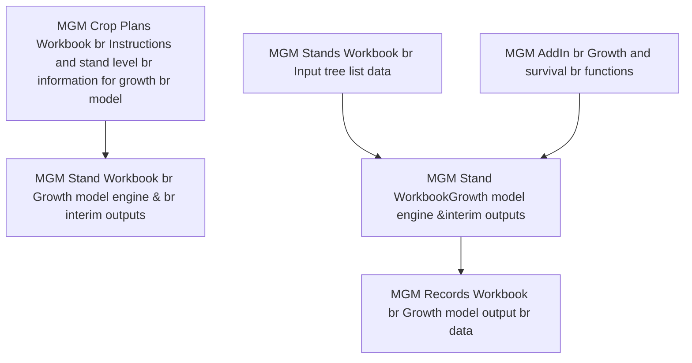
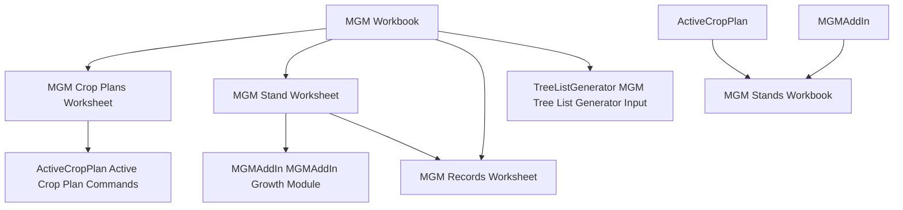
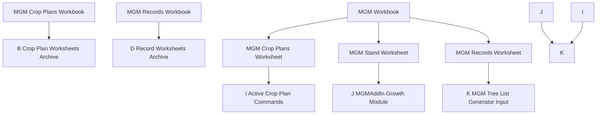

# **Best Practices for Using the Mixedwood Growth Model (MGM21 – VS8.2.21.39 / Rev6378)**

February 28, 2022

Kirk Johnson, Phil Comeau, and Mike Bokalo

**UNIVERSITY OF ALBERTA**
**DEPARTMENT OF RENEWABLE RESOURCES**

---

# Table of Contents

**1.0 INTRODUCTION** .................................................................................... **1**

**2.0 MIXEDWOOD GROWTH MODEL INSTALLATION** .................................... **1**

**3.0 MIXEDWOOD GROWTH MODEL - OVERVIEW** ...................................... **1**

**4.0 MGM'S ARCHITECTURE AND SITE INDEX** .......................................... **2**

**5.0 INPUT DATA** ....................................................................................... **5**
- 5.1 MGM's ARCHITECTURE AND INPUT DATA .................................... **5**
- 5.2 OBSERVED TREE LISTS (PREFERRED) .......................................... **5**
- 5.3 SAMPLING REQUIREMENTS AND RECOMMENDATIONS FOR OBSERVED TREE LISTS ........................................................ **5**
- 5.4 SIMULATED TREE LISTS .................................................................... **6**
- 5.5 ENSURING TREE LIST GENERATOR SOLUTIONS ............................ **6**
- 5.6 SAMPLING REQUIREMENTS FOR SIMULATED TREE LISTS ............... **7**
- 5.7 REFORESTATION STANDARD OF ALBERTA PERFORMANCE SURVEY DATA ........................................................................................ **7**
- 5.8 OTHER INPUT DATA ......................................................................... **7**

**6.0 PLOT AND STAND DEFINITIONS** ....................................................... **8**

**7.0 SITE INDEX ESTIMATION** ................................................................... **9**
- 7.1 SITE INDEX AND TOP HEIGHT ....................................................... **9**
- 7.2 TOP HEIGHT, AGE, AND SITE INDEX IN ALBERTA ........................ **10**
- 7.3 TOP HEIGHT, AGE, AND SITE INDEX IN SASKATCHEWAN, MANITOBA AND BRITISH COLUMBIA ........................................................ **11**
  - *7.3.1 Top Height Trees in Saskatchewan, Manitoba, and British Columbia* ........................................................ **11**
  - *7.3.2 Estimating Site Index with the Saskatchewan, Manitoba, and British Columbia Curves* ........................................................ **12**
- 7.4 JACK PINE SITE INDEX IN ALBERTA, SASKATCHEWAN, MANITOBA, AND BRITISH COLUMBIA ........................................................ **13**
- 7.5 JACK PINE AND LODGEPOLE PINE HYBRIDS IN ALBERTA ............... **13**
- 7.6 OTHER SITE INDEX SOURCES ......................................................... **14**
- 7.7 ECOLOGICALLY REASONABLE SITE INDEX ESTIMATES .................... **15**
- 7.8 SITE INDEX LIMITS ......................................................................... **16**

**8.0 STAND AGE AT INITIALIZATION** ..................................................... **16**

**9.0 MGM COMPONENTS AND STRUCTURE** ............................................. **17**
- 9.1 MGM WORKBOOK ............................................................................ **17**
- 9.2 MGM STANDS WORKBOOK ............................................................ **18**
- 9.3 MGM RECORDS WORKBOOK ........................................................... **18**
- 9.4 MGM CROP PLANS WORKBOOK ..................................................... **19**
- 9.5 DATA FLOW IN MGM ...................................................................... **20**
- 9.6 CREATING MGM STAND WORKSHEETS ........................................... **22**

**10.0 PREPARING CROP PLANS** .............................................................. **22**
- 10.1 CROPPLANSID ................................................................................. **22**
- 10.2 CROP PLAN EVENT ........................................................................ **22**
- 10.3 OPTIONS EVENT ............................................................................. **23**
- 10.4 ESTABLISH EVENT ......................................................................... **27**
- 10.5 GROW EVENT ................................................................................. **29**
- 10.6 END EVENT .................................................................................... **29**

---

10.7 RECORD EVENT (OPTIONAL) ............................................................ 29
10.8 VISUALIZE EVENT (OPTIONAL) ............................................................ 29
10.9 USING THE TREE LIST GENERATOR .................................................... 30

**11.0 MGM RECORD EXTRACTOR** ............................................................ **31**

**12.0 BATCH PROCESSING – MGM BATCH MACRO** ................................. **31**

**13.0 ACKNOWLEDGEMENTS** ................................................................. **32**

**14.0 LITERATURE CITED** ......................................................................... **32**

**APPENDIX 1 – EXAMPLE CROP PLAN** .................................................... **35**

**APPENDIX 2 – MGM YIELDS DATA DICTIONARY** .................................... **36**

---

# Best Practices for Using the Mixedwood Growth Model (MGM21)

## **1.0 INTRODUCTION**

This Mixedwood Growth Model (MGM) Best Practices document is intended to help users deploy MGM in common growth and yield contexts. For more complex situations or procedures, we recommend that you obtain assistance from others with experience using MGM or that you contact the Developer (Mike Bokalo) at <u>mike.bokalo@ualberta.ca</u>.

When using MGM for forest management planning, provincial forest management planning protocols should be followed. In some cases, it may be necessary to consult your provincial forest regulator and/or the MGM Developer (<u>mike.bokalo@ualberta.ca</u>).

## **2.0 MIXEDWOOD GROWTH MODEL INSTALLATION**

Detailed instructions for downloading and installing MGM, including videos, are available on the MGM Download page (<u>https://mgm.ualberta.ca/mgm21/download-requirements/</u>). Detailed instructions for downloading and installing the Stand Visualization System (SVS) are also available on the MGM Download page. (SVS is a program developed by Bob McGaughey and the U.S. Forest Service to create images that illustrate stand structure.) **All installation instructions should be followed carefully to ensure that MGM and SVS are successfully installed.**

Documentation and other materials are available from the MGM website (<u>https://mgm.ualberta.ca/</u>).

## **3.0 MIXEDWOOD GROWTH MODEL - OVERVIEW**

MGM is a deterministic, distance-independent, individual tree-based stand growth model for the boreal forest. MGM is capable of modeling pure or mixed stands of white spruce, trembling aspen, lodgepole pine, jack pine, and black spruce. Among the forest growth models for northern BC, the southern NWT, Alberta, central Saskatchewan, and Manitoba, MGM has the unique ability to model tree-level growth in mixed-species stands. MGM also complements other tree-level growth models for northern British Columbia. <mark>MGM's tree-level / mixed-species architecture supports the modeling of multi-cohort stands (Grover et al. 2014), managed-stand treatments (Bokalo et al. 2013; Comeau 2014; Comeau and Fraser 2018; Comeau 2021a; Bjelanovic et al. 2021), and fire-origin boreal forests (Bokalo et al. 2013). MGM can also model discrete spatial treatments like understory protection (Grover et al. 2014) and stands attacked by mountain pine beetle (Dempster and Meredith 2021). In addition, this version of MGM includes climate-sensitive survival functions (Cortini et al. 2017; Comeau 2021b) and a climate sensitive maximum size-density relationship (Comeau 2021c).</mark>

1

---

MGM's growth and survival relationships are based on data from across the western boreal forest (Table 1). Recent submodel updates have been published in Strimbu et al. (2017), Cortini et al. (2017), Comeau (2021a), Comeau (2021b), and Oboite and Comeau (2021). Regional variants of MGM are also available for Alberta, Saskatchewan, Manitoba, and northeastern British Columbia. These variants allow the use of local species codes, site index curves, and taper equations (Table 2). More details are available at: <u>https://mgm.ualberta.ca/</u>.

## 4.0 MGM's Architecture and Site Index

<mark>MGM is a "height-driven model" that uses provincial site index curves</mark> (height-age-site index models) to predict the maximum potential height increment for each tree. Trees are then ranked by DBH (Diameter at Breast Height) and competition-adjusted height increment, diameter increment, and survival (Table 1) are calculated. Dominant trees are subject to less competition and, as a result, grow quickly and are more likely to survive while suppressed trees experience substantial competition and grow slowly and are less likely to survive. In the model, tree-level height, diameter, tree factor1, basal area, and volume are updated annually using competition-adjusted growth information. Tree-level characteristics are summarized for each stand to determine stand-level average height, average diameter at breast height (DBH), and stand density, stand basal area, and stand volume. User-defined merchantability criteria are applied after tree-level growth is complete.

Given MGM's heavy reliance on site index, accurate site index estimates are essential to run MGM and produce realistic outcomes. Poor site index estimates may adversely affect MGM's predictions. Site index curves and volume equations used in MGM for each province are indicated in Table 2.

----

1 Tree factor is the number of trees per hectare that are represented by each tree in a treelist (i.e. the relative weight of each tree), based on the area of the sample plot. Tree Factor = 10,000 m2 / sample plot area (m2)

2

---

Table 1. Data origin for MGM's height increment, diameter increment, and survival submodels by species. These submodels apply to all regional variants. * = MGM's "primary species" with species-specific height increment, diameter increment, and survival submodels (i.e. white spruce, lodgepole pine, jack pine, trembling aspen, and black spruce). ◇ = MGM's "secondary species" use the submodels of MGM's "primary species". Some "secondary species" include species-specific survival submodels (e.g. balsam poplar).

| Modeled Species      | Height Increment                                                    | Diameter Increment                                                  | Survival                                                          |
| -------------------- | ------------------------------------------------------------------- | ------------------------------------------------------------------- | ----------------------------------------------------------------- |
| White Spruce\*       | Alberta (Stadt unpubl.)                                             | Alberta (Stadt unpubl.)                                             | Alaska to Manitoba (Cortini et al. 2017)                          |
| Lodgepole Pine\*     | Alberta                                                             | Alberta                                                             | Alaska to Manitoba (Comeau 2021a)                                 |
| Jack Pine\*          | Alberta, Saskatchewan, and Manitoba (Strimbu et al. 2017)           | Alberta, Saskatchewan, and Manitoba (Strimbu et al. 2017)           | Alaska to Manitoba (Comeau 2021a)                                 |
| Trembling Aspen\*    | Alberta (Stadt unpubl.)                                             | Alberta (Stadt unpubl.)                                             | Alaska to Manitoba (Cortini et al. 2017)                          |
| Black Spruce\*       | Alaska to Manitoba (Oboite and Comeau 2021)                         | Alaska to Manitoba (Oboite and Comeau 2021)                         | Alaska to Manitoba (Comeau 2021a)                                 |
| Balsam Fir◇          | Alberta (Stadt unpubl.) - White Spruce Submodel                     | Alberta (Stadt unpubl.) - White Spruce Submodel                     | Alaska to Manitoba (Comeau 2021a)                                 |
| Subalpine Fir◇       | Alberta (Stadt unpubl.) - White Spruce Submodel                     | Alberta (Stadt unpubl.) - White Spruce Submodel                     | Alaska to Manitoba (Comeau 2021a) - Balsam Fir Submodel           |
| Douglas-fir◇         | Alberta (Stadt unpubl.) - White Spruce Submodel                     | Alberta (Stadt unpubl.) - White Spruce Submodel                     | Alaska to Manitoba (Cortini et al. 2017) - White Spruce Submodel  |
| Balsam Poplar◇       | Alberta (Stadt unpubl.) - Trembling Aspen Submodel                  | Alberta (Stadt unpubl.) - Trembling Aspen Submodel                  | Alaska to Manitoba (Cortini et al. 2017)                          |
| White (Paper) Birch◇ | Alberta (Stadt unpubl.) - Trembling Aspen Submodel                  | Alberta (Stadt unpubl.) - Trembling Aspen Submodel                  | Alaska to Manitoba (Cortini et al. 2017) - Balsam Poplar Submodel |
| Tamarack◇            | Alaska to Manitoba (Oboite and Comeau 2021) - Black Spruce Submodel | Alaska to Manitoba (Oboite and Comeau 2021) - Black Spruce Submodel | Alaska to Manitoba (Cortini et al. 2017) - Black Spruce Submodel  |

3

---

Table 2. MGM's site index curves and taper equations by regional variant.

<table>
  <thead>
    <tr>
      <th>Regional Variant</th>
      <th>MGM Region Code</th>
      <th>Site Index Curves</th>
      <th>Taper Equations</th>
    </tr>
  </thead>
  <tbody>
    <tr>
      <td>Alberta</td>
<td>1</td>
<td>GIPSY Site Index Curves (Huang et al. 2009)</td>
<td>Natural Subregion Taper Equations (Huang 1994)</td>
    </tr>
<tr>
      <td>British Columbia</td>
<td>2</td>
<td>British Columbia Provincial Site Index Curves2</td>
<td>BEC (SWBS and SBS) Taper Equations (Kozak 1994)</td>
    </tr>
<tr>
      <td>Saskatchewan</td>
<td>3</td>
<td>Saskatchewan Provincial Site Index Curves3</td>
<td>Saskatchewan Provincial Taper Equations (Gal and Bella 1994)</td>
    </tr>
<tr>
      <td>Manitoba</td>
<td>4</td>
<td>Saskatchewan Provincial Site Index Curves3</td>
<td>Saskatchewan Provincial Taper Equations (Gal and Bella 1994)</td>
    </tr>
  </tbody>
</table>

MGM's "secondary species" (Table 1) use the site index curves for MGM's "primary species" in each Regional Variant (Table 2):

- Balsam Fir - Uses the white spruce site index curve.
- Subalpine Fir - Uses the white spruce site index curve.
- Douglas-fir - Uses the white spruce site index curve.
- Balsam Poplar - Uses the trembling aspen site index curve.
- White Birch - Uses the trembling aspen site index curve.
- Tamarack - Uses the black spruce site index curve.

2 MGM uses the following Ministry Recommended site index curves in SiteTools 4.1 (BCMFLNRO 2017) in the British Columbia variant. Site index is only modeled for MGM's "primary species" (Table 1.)
- White Spruce – Goudie (1984) with an age correction
- Lodgepole Pine – Thrower (1994)
- Jack Pine – Huang (1997) with an age correction
- Trembling Aspen – Nigh et al. (2002a) provincial equation
- Black Spruce – Nigh et al. (2002b) provincial equation

3 MGM uses the following Saskatchewan Provincial Site Index curves in the Saskatchewan and Manitoba variants. Site index is only modeled for MGM's "primary species" (Table 1.)
- White Spruce – Hu and Garcia (2010)
- Lodgepole Pine – Cieszewski et al. (1993)
- Jack Pine – Fang (2007)
- Trembling Aspen – Nigh et al. (2002a) BWBS equation
- Black Spruce – Huang et al. (1997) Central Mixedwood equation

4

---

# 5.0 INPUT DATA

## 5.1 MGM's Architecture and Input Data
To predict competition-adjusted growth, MGM simulates local competition using tree-level information within area-based plots. As a result, MGM requires <u>fully enumerated tree-level measurements</u> (i.e. species, height, and DBH) within <u>area-based plots</u>. Simulated tree lists may also be developed for juvenile stands (Trees ≤ 25 years total age) using MGM's Tree List Generator (TLG) and plot summary statistics. Ideally, stands should be well established; generally, this corresponds with Performance Survey Age (i.e. 12-14 years old).

## 5.2 Observed Tree Lists (Preferred)
Nested plots (e.g. AAF 2015) are recommended to initialize MGM with tree-level information. Nested plots characterize local competition and capture a range of tree sizes while supporting efficient data collection. To support simulation of long-term stand dynamics in MGM, nested plots must sample large, intermediate, and small trees (Conifers ≥ 0.3 m and Deciduous ≥ 1.3 m). A minimum height of 0.3 m for conifers and 1.3 m for deciduous aligns with Alberta's Provincial Growth and Yield Initiative (AAF 2015) and the Reforestation Standard of Alberta (AAF 2021), though MGM can handle stems that are smaller. Please see the "Site Index Estimation" section for a discussion of top height sampling and site index estimation.

Most Permanent Sample Plot (PSP) protocols with a nested design adequately sample stands for MGM. For example, the Alberta Provincial Growth and Yield Initiative (PGYI; AAF 2015) outlines best practices for PSP establishment that include a variety of subplot sizes and diameter limits that capture a range of tree sizes and stand structures.

1. Main Plot (400 m²) – All trees ≥ 5.1 cm DBH
2. Sapling Plot (100 m²) – All trees ≥ 1.3m height
3. Regeneration Plot (40 m²) – All conifer trees ≥ 0.30m height

PGYI (AAF 2015) plot sizes and diameter limits are suitable to initialize and run MGM.

## 5.3 Sampling Requirements and Recommendations for Observed Tree Lists

<u>Minimum Requirements</u>

1. Tree-level measurements on all live trees which should include species, height, DBH, and plot area within area-based plots.
2. If applicable, tree-level measurements should sample large, intermediate, and small trees (Conifers ≥ 0.3m and Deciduous ≥ 1.3m).
3. Plots should be distributed in an unbiased fashion with a robust sampling design. The use of random, stratified random or systematic distributions of sample plots is common practice.

<u>Recommendations</u>

1. Whenever possible, nested plots should sample at least 100 m² but should ideally sample 200 or 400 m² for modeling long-term stand dynamics in MGM. (Sampling requirements for site index estimation

5

---

are often more stringent and may require larger plot sizes. Please see the "Site Index Estimation" section below for details.)

2. Tree condition codes can be sampled to aid tree list filtering. Dead trees should be filtered out. If tree list filtering is performed on live trees, document the filtering criteria (e.g. removed mature trees with a severe breakage in the lower bole), and follow all relevant provincial protocols.

Please see the "Creating MGM Stand Worksheets" section for instructions on building MGM Stand worksheets.

## 5.4 Simulated Tree Lists

Simulated tree lists may also be developed for juvenile stands (trees ≤ 25 years) using MGM's Tree List Generator (TLG) and initialized using summary statistics. MGM's TLG requires: trees/ha, maximum height, average height, the standard deviation of height, average DBH, the standard deviation of DBH, and age for each species. Given the natural variability of forest systems, Simulated Tree Lists should be initialized with observed data and/or data that acknowledges correlated stand conditions. Height and diameter characteristics (i.e. average height, the standard deviation of height, average DBH, and the standard deviation of DBH) are influenced by stand composition, stand density, stand structure, and other factors. (Example 1: Natural/unthinned stands have different height and diameter summary statistics than thinned stands. Example 2: Pure conifer stands have different height and diameter summary statistics than mixedwood stands.) As a result, stand summary statistics entered into the TLG need to represent the actual (real) stand conditions. (Example 1: Height and diameter summary statistics for natural/unthinned stands should not be used to initialize thinned stands. Example 2: Height and diameter summary statistics for pure conifer stands should not be used to initialize mixedwood stands.) Unrealistic stand structures can be created with the TLG if stand summary statistics are "mixed and matched" across stand types. Section 10.9 provides further instructions on use of the tree list generator.

## 5.5 Ensuring Tree List Generator Solutions

When the the Tree List Generator (TLG) is used to add a cohort within the the crop plan dialogue, the TLG input data are tested to ensure that a TLG solution can be achieved. The TLG currently restricts the minimum and maximum standard deviation of DBH (sdDbh) to between 15% and 30% of the average DBH (coefficient of variation (CV) is between 15% and 30%). MGM projections are highly sensitive to initial size and standard deviation, consequently care should be exercised when this assumption regarding the minimum and maximum standard deviation (and therefore the size structure of the stand) is not met. When adjustments are made within the dialogue, MGM will notify the user that the standard deviation of diameter has been changed. When manually changing the sdDBH parameter, or executing a batch run, the execution of the establish event will restrict the CV to between 15% and 30%. Additionally, for stands that have an average height of 1.3 m or larger, the minimum average diameter cannot be less than 0.5 cm.

6

---

# 5.6 Sampling Requirements for Simulated Tree Lists

TLG summary statistics should be obtained for each species in a stand. Then, these species-specific summary statistics are used to initialize individual cohorts in the TLG dialog. TLG summary statistics must also acknowledge any "special cohorts" that are created through stand tending and/or natural regeneration. For example, tended aspen stands may contain a primary cohort of large "crop tree" aspen and a secondary cohort of small aspen that regenerated following tending. In this case, separate TLG summary statistics should be entered for each of the large and small aspen cohorts. TLG summary statistics must also exclude trees greater than 25 years old since the TLG was not designed to be used on trees > 25 years. In cases where veterans are part of the stand structure, they can be input as an actual treelist.

Please see the section 10.9 "Using the TLG" for instructions on TLG operation.

# 5.7 Reforestation Standard of Alberta Performance Survey Data

Performance Surveys under the 2021 Reforestation Standard of Alberta (RSA; AAF 2021) were not designed for use with MGM. As a result, RSA Performance Surveys do not sample full tree lists that are needed to directly initialize MGM or sample height and diameter distributions to use MGM's TLG. Consequently, Performance Survey data under the 2021 Reforestation Standard of Alberta cannot be used to directly initialize MGM.

A review of possible options that would make the 2021 Reforestation Standard of Alberta compatible with MGM is being considered by the GOA.

# 5.8 Other Input Data

Mean Climate Moisture Index (CMI) from 1981-2010 is required to run MGM's climate-sensitive survival functions (Cortini et al. 2017; Comeau 2021a) and maximum size-density relationship (Comeau 2021b).

## **Mean Climate Moisture Index (Hogg et al. 2013) <u>MUST:</u>**

**1. <u>Be calculated using <u>ClimateNA (Wang et al. 2016) <u>Version 6.11</u> data and the MGM CMI Solver.</u> (Other versions of ClimateNA (Versions 6.20+) <u>may not</u> be used to calculate CMI.)**

**2. Use the reference period 1981-2010.**

\*\*Please see the "Calculating CMI" section below to get the MGM CMI Solver, ClimateNA Version 6.11, and instructions to calculate CMI.

*Why ClimateNA Version 6.11*

- All of the climate sensitive functions in MGM21 (Cortini et al. 2017; Comeau 2021a; Comeau 2021b) were calibrated using climate data from ClimateNA Version 6.11 or earlier.
- **ClimateNA's historic monthly data underwent a major revision in Version 6.20. This revised climate data produces substantially different CMI values than those used to calibrate MGM and conversion between values provided by these two versions of ClimateNA is not possible. <u>As a result, <u>ClimateNA <u>Version 6.11 <u>must be used to calculate CMI for MGM21.</u>**

7

---

- **The newest versions of ClimateNA (Versions 6.30+) directly output CMI. <u>CMI values that are directly output from ClimateNA should not be used with MGM21.</u> The newest versions of ClimateNA also include revised climate data that differs from ClimateNA Version 6.11.**

### *Climate Change and MGM21*

- **It is important to note that **MGM21 DOES NOT** model climate change directly.**
- A prototype version of MGM is being developed to explore climate change under a project sponsored by Alberta-Pacific Forest Industries and Saskatchewan Environment.

### *Calculating CMI*

CMI should be calculated using the MGM CMI Solver but must use ClimateNA Version 6.11 data from 1981-2010. Please see the “MGM CMI Solver” section on the MGM Download page (https://mgm.ualberta.ca/mgm21/download-requirements/) to get the MGM CMI Solver, ClimateNA Version 6.11, and instructions to calculate CMI.

The MGM CMI Solver documentation outlines:

1. How to prepare input data for ClimateNA Version 6.11.
2. How to install and run ClimateNA Version 6.11.
3. How to calculate CMI using the MGM CMI Solver.

## **6.0 PLOT AND STAND DEFINITIONS**

In the context of MGM, “plots” are an area-based sample of trees that represent a stand. Stands may be represented by data from one discrete/fully enumerated plot (e.g. an isolated Permanent Sample Plot with tree-level measurements). However, many forest measurement protocols and experimental designs sample two or more discrete/fully enumerated plots within a stand. When two or more discrete/fully enumerated plots are sampled per stand, each plot is a partial representation of the stand or stand-level treatment. In these cases, we feel it is best to model each plot separately in MGM, where plots are of sufficient size, and average the plot-level outcomes to obtain a stand-level or treatment outcome. However, where blocks are stratified into areas that are homogeneous in terms of stand density, composition, structure, and tree sizes, then plots may be effectively pooled to provide a single tree list that represents the strata that is sampled. While 50m2 and smaller plots can be adequate for sampling in young stands, aggregation of plots may be necessary when plots that are 50m2 or smaller. When small plots are aggregated, care must be exercised to ensure that the individual small plots being aggregated are very similar in structure (tree sizes and their distribution) and composition.

8

---

# Rationale for <u>Not</u> Combining Tree Data from Discrete/Fully Enumerated Plots

1. When combining the tree data from several discrete/fully enumerated plots, stand structure and competition may not accurately represent actual stand conditions. For example, a spruce plantation could contain a conifer-leading plot with medium-sized spruce and a deciduous-leading plot with large aspen and suppressed spruce. Combining the tree data for these plots would produce an artificial stand structure with large aspen over medium-sized and suppressed spruce.
2. Unrealistic stand structures can also be created with MGM's Tree List Generator by combining data or summary statistics from areas that differ in structure or composition (i.e. in areas that are not homogeneous).

When discussing MGM projections, the terms "stand growth" and "stand yield" can apply to: 1) individual plots that represent a single stand, or 2) stand-level averages from 2 or more plot-level MGM projections.

In the MGM software and Graphical User Interface (GUI), "stands" refer to MGM Stand Worksheets in the MGM Stands Workbook (e.g. MGM Stands.xlsx) or simulated tree lists from MGM's Tree List Generator.

## **7.0 SITE INDEX ESTIMATION**

MGM projections require site index estimates [i.e dominant height (**m**) @ <u>50 years</u> **breast height age**] for each "primary species" that exists on a plot. MGM's "primary species" include: white spruce, lodgepole pine, jack pine, trembling aspen, and black spruce (Table 1). Site index estimates strongly influence all MGM outcomes (e.g. height, diameter, volume, basal area) and the modeling of successional dynamics of all species. Site index estimation demands a thoughtful approach that includes careful top height tree selection, considers stand conditions (e.g. age, management history), and targets a specific set of site index curves (i.e. height-age-site index models). Users should also be aware that site index estimates for small trees (i.e. trees <5 m in height, and particularly for trees less than 2 or 3 m in height) can be unreliable since the growth of small, young trees (particularly conifers) can be influenced by local microsite conditions, competition, years since release, and other factors. In addition, site index values used in MGM should be estimated for trees that are in dominant or codominant canopy positions. Site index derived from dominant or codominant trees is the traditional expression of site index (e.g. Huang et al. 1997; Nigh et al. 2002b; Raulier et al. 2003).

## **7.1 Site Index and Top Height**

Site index (i.e. dominant height (m) @ 50 years breast height age) is a plant-based (phytocentric) measure of productivity in even-aged stands. In western Canada, site index is assessed using "top height" trees which are typically the thickest diameter trees in a species' cohort and may (or may not) be subject to additional selection criteria4. For MGM, top height trees are defined as the 100 largest diameter dominant and codominant trees per hectare of each primary species group.

----

4 Alberta currently allows understory spruce to inform site index estimates for GYPSY projections. However, understory spruce are unsuitable for determining site index in MGM. MGM's height increment functions require that the top height

9

---

# **7.2 Top Height, Age, and Site Index in Alberta**

<u>Permanent Sample Plots and Temporary Sample Plots</u>

On Permanent Sample Plots in Alberta, dominant height and age should be sampled using the Provincial Growth and Yield Initiative (PGYI) protocol (AAF 2015). For Permanent Sample Plots, the PGYI recommendation is to determine age and height (for SI purposes) outside main plots so as not to leave core holes in plot stems. For Temporary Sample Plots in Alberta, age and top height sampling may occur within the "Main Plot".

<u>Top Height and Age in Juvenile Alberta Stands</u>

In juvenile Alberta stands, top height and age should be sampled using the protocols in the Reforestation Standard of Alberta (AAF 2021) for each of MGM's "primary species".

<u>Calculating Site Index in Alberta</u>

In Alberta, use the GYPSY site index curves (Huang et al. 2009) to calculate site index for each of MGM's "primary species". The "Forestry Toolbox add-in for Microsoft Excel" (fRI Research 2021) can be used to calculate GYPSY site index based on height-total age, height-stump age, and height-breast height age information. For advanced users, the GYPSY manual (Huang et al. 2009) includes a SAS program to calculate site index. However, the SAS program in the GYPSY manual does not include automatic height-stump age or height-breast height age conversions. **MGM requires all GYPSY site index estimates to be expressed as "breast height age site index" (m@50 years breast height age) (SIBH).**

On top height plots > 100m2, GYPSY site index should be estimated using the average height of top height trees and average age for each primary species. On 100m2 top height plots, since there is only one top height tree per plot, top height and age do not need to be averaged for each primary species. Be sure to remove veterans, advance growth, "wolf trees", and trees with moderate to severe lean, sweep, dead tops or broken tops.

__________________

trees used to calculate site index represent trees growing at full site potential, without suppressed height growth. As a result, MGM requires that the top height trees used to calculate site index be defined as the 100 largest diameter dominant and codominant unsuppressed trees per hectare (e.g. Huang et al. 1997; Nigh et al. 2002b; Raulier et al. 2003) of each primary species group.

10

---

# **7.3 Top Height, Age, and Site Index in Saskatchewan, Manitoba and British Columbia**

## **7.3.1 Top Height Trees in Saskatchewan, Manitoba, and British Columbia**

Top height trees should meet the following criteria:

1. Top height trees should be dominant/codominant and free of major stem deformities (e.g. forks, crooks, extreme sweep, etc.).
2. Top height trees should not have any history of suppression.
3. Top height trees should be sampled at a rate of 1 tree per 100 m2 of plot area. For example, one top height tree should be sampled in a 100m2 plot, and two top height trees should be sampled in a 200 m2 plot. Plot sizes <100 m2 do not adequately sample top height and in these cases, a larger 100 m2 should be used. To obtain an adequate sample of representative top height trees, top height should generally be sampled using plots ≥ 200 m2. On Permanent Sample Plots (PSP's), top height trees are often sampled in plot buffers to minimize damage (due to coring) on trees within the PSP.
4. Top height trees should be old enough to estimate site index. Current recommendations are 10-20+ years-old for trembling aspen, 10-20+ years-old for pine, and 20-35+ years-old for spruce. In general, site index prediction error is high during early stand development. However, site index prediction error declines as stands become well-established, achieve crown closure, and/or approach the 50-year reference age of most site index curves. For more information, please see the documentation for your provincial site index curves.
5. Top height trees should not be extremely old. In general, site index prediction error tends to drift or increase in stands >100 years-old. For more information, please see the documentation for your provincial site index curves.
6. Top height trees should not have a rotten bole that cannot be aged.
7. Top height trees should not be veterans that survived 1 or more stand-replacing disturbances (e.g. fire, clearcut harvesting, diameter-limit harvesting).
8. Top height trees should not be sampled from stands that experienced diameter limit cutting, uneven-aged management, or understory protection/understory avoidance partial cutting or other similar treatments that remove dominant trees and substantially alter stand structure.

11

---

# 7.3.2 **Estimating Site Index with the Saskatchewan, Manitoba, and British Columbia Curves**

The height-age-site index curves for Saskatchewan5, Manitoba, and British Columbia6 are stem analysis (SA) based curves for MGM's "primary species". These curves are based on tree-level top height and "breast height age" (i.e. age @ 1.3m height). As a result, tree-level top height and breast height age should be used to estimate site index with the SA curves. Site index estimates for the SA curves can be calculated using Site Tools7 (BCMFLNRO 2017) for British Columbia or the "SK_Site_Index_Library.xlam" tool for Saskatchewan and Manitoba. Observed "breast height age" should be used to estimate site index with SA curves whenever possible.

## **Basic Procedure for Estimating Site Index using Stem Analysis Based Curves**

1. Compile your top height tree information (i.e. tree-level height-age pairs) into a tabular format that includes stand ID, plot ID, tree ID, species code (i.e. white spruce, jack pine, lodgepole pine, trembling aspen, and black spruce) and condition code.
2. Remove top height trees with disqualifying condition codes.
3. Review the range of height and breast height age for each species on each top height plot. Large differences in height or breast height age may indicate an uneven-aged stand or the presence of advance regeneration. Remove obvious advance regeneration, and/or consider other site index sources for uneven-aged stands.
4. Next, calculate tree-level site index estimates with the program for your SA curves (i.e. Site Tools or "SK_Site_Index_Library.xlam" tool). If using an analytical platform like SAS or R, make sure to use the appropriate parameters and curve form for each species (i.e. white spruce, jack pine, lodgepole pine, trembling aspen, and black spruce).
5. Then, average the site index estimates for each species on each top height plot. Make sure that the average site index estimates include the stand ID, plot ID, and species code. If using plot-level site index estimates, proceed to Step 7.

----

5 MGM uses the Saskatchewan Provincial Site Index curves in the Saskatchewan and Manitoba variants. Site index is only modeled for MGM's "primary species" (Table 1.)
- White Spruce – Hu and Garcia (2010)
- Lodgepole Pine – Cieszewski et al. (1993)
- Jack Pine – Fang (2007)
- Trembling Aspen – Nigh et al. (2002a) BWBS equation
- Black Spruce – Huang et al. (1997) Central Mixedwood equation

6 MGM uses the following Ministry Recommended site index curves in SiteTools 4.1 (BCMFLNRO 2017) in the British Columbia variant. Site index is only modeled for MGM's "primary species" (Table 1.)
- White Spruce – Goudie (1984) with an age correction
- Lodgepole Pine – Thrower (1994)
- Jack Pine – Huang (1997) with an age correction
- Trembling Aspen – Nigh et al. (2002a) provincial equation
- Black Spruce – Nigh et al. (2002b) provincial equation

12

---

6. If using stand-level site index estimates, average the site index estimates for each species in each stand using the plot-level averages from Step 5. Make sure that the average site index estimates include the stand ID and species code.
7. Enter these site index estimates into your tree list data and **MGM Stand Worksheets**.
8. Do not use site index estimates from GYP SY or other **MGM Variants** in Saskatchewan, Manitoba or British Columbia.

## **7.4 Jack Pine Site Index in Alberta, Saskatchewan, Manitoba, and British Columbia**

In Alberta, the GYP SY site index curves do not include a separate equation for jack pine (Huang et al. 2009). As a result, MGM models Alberta jack pine using the GYP SY site index curve for lodgepole pine. Jack pine site index in Alberta should be estimated using the GYP SY site index curve for lodgepole pine (Huang et al. 2009). In Saskatchewan, Manitoba, and British Columbia, MGM models jack pine and lodgepole pine using separate site index equations. As a result, site index for jack pine and lodgepole pine should be estimated using the provincial jack pine or lodgepole pine equation, as appropriate.

When creating MGM Stand Worksheets or MGM Crop Plans, jack pine site index should be placed in the pine or "PL" placeholder. (MGM21 does not accommodate modeling both jack pine and lodgepole pine in a single stand.)

## <u>7.5 Jack Pine and Lodgepole Pine Hybrids in Alberta</u>

Jack pine and lodgepole pine are modeled using different height increment, diameter increment, and survival functions in MGM. Therefore, users must select <u>either</u> jack pine or lodgepole pine when modeling hybrid pine in Alberta. As a coarse rule for Alberta, pine west of -114° longitude (i.e. the 5th Meridian) might be classified as lodgepole pine, and pine east of -114° longitude could be classified as jack pine. Burns et al. (2019) provides a map indicating the spatial delineation of the jack pine – hybrid – lodgepole pine regions developed using SNP markers (Figure 1).

13

---

Burns et al. 851

Fig. 3. Predictive map for lodgepole pine, jack pine, and their hybrids based on the spatial model, which includes geographic location. Predicted Q values are indicated by the species class colour at each geographic location, with dark green representing lodgepole pine, light green representing jack pine, and blue indicating hybrid pine. Yellow circles indicate sample sites included in this study. Grey lines and dotted black lines indicate the proposed distributions of lodgepole pine and jack pine, respectively, from <u>Little (1971)</u>.

| Category                   | Description |
| -------------------------- | ----------- |
| Sample locations           | ●           |
| Jack pine range            | ····        |
| Lodgepole pine range       | □           |
| **Predicted model**        |             |
| Jack pine                  | Light green |
| Hybrids (ancestry 0.1-0.9) | Orange      |
| Lodgepole pine             | Dark green  |

Figure 1. Map showing the distribution of lodgepole pine, jack pine and hybrids developed by Burns et al. (2019) based on SNP markers.

## **7.6 Other Site Index Sources**

Top height information collected in the same stand prior to harvest can provide excellent estimates of site index, where suitable top height trees can be measured. Top height information from an adjacent, ecologically similar, but unharvested stand may be used as an alternative site index source, provided the adjacent stands are mature, even-aged, and ecologically similar. However, this method may not always properly characterize local site productivity. For example, small elevation differences between two adjacent stands can have a large impact on soil moisture, site productivity, and stand dynamics. Finding mature, unharvested, adjacent stands may also be difficult in areas with substantial harvesting. In addition, overmature stands may not accurately reflect the site index of regenerated stands.

Growth intercept methods can be applied to estimate site index in young stands, where suitable trees free of overtopping competition can be measured, and where suitable growth intercept equations are available.

If suitable top height and age information is not available (e.g. very young or very old stands, or where a species is overtopped by another such as where white spruce is growing under taller trembling aspen), site index may be estimated using ecosite-based relationships, or species-site index conversion equations. For best results, the accuracy, precision, and application(s) of these site index sources should be evaluated (e.g. Kayahara et al. 1998) and compared to local averages for similar strata/stand types growing on similar sites before use with MGM.

Ecosite guides can also be used as a site index source. These guides often capture regional trends in site index. However, guide-based site indices may lack precision on a local site-by-site basis. Guide-based site indices that were developed from extremely small samples should be used with caution.

14

---

<u>Ecosite-Based Site Index Values:</u>

- In Northern Alberta, West-Central Alberta, and Saskatchewan, site index values for white spruce, pine, and trembling aspen based on ecosite are available in <u>MGM Research Note #2019-1</u> (Bjelanovic and Comeau 2019a). For black spruce ecosite based site index values are provided in <u>MGM Research Note #2020-1</u> (Comeau 2020).
- In Southwest Alberta, ecosite based site index values for white spruce, pine, trembling aspen, and black spruce can be found in Archibald et al. (1996).
- In British Columbia and Manitoba, site index values for white spruce, pine, trembling aspen, and black spruce <u>MGM Research Note #2020-1</u> (Comeau 2020) summarizes values by ecological unit .

The use of site index conversion equations (e.g. SwSI = 0.80 × AwSI) should be avoided. However, if necessary, Alberta site index conversion equations in <u>MGM Research Note #2019-2</u> (Bjelanovic and Comeau 2019b) are available for trembling aspen, white spruce, and lodgepole pine. Site index conversion equations for British Columbia are available in Site Tools (BCMFLNRO 2017).

Recommended methods for estimating site index, in order of preference, are: 1) direct measurement in the stand, provided suitable top height trees of appropriate height are available; 2) preharvest measurement of top height trees in the same block; 3) measurement of top height trees in nearby stands that are ecologically similar; 4) use of ecosite/site series based estimates of site index; and, 5) use of site index conversion equations. All site index sources should be evaluated carefully and compared to local averages for similar strata/stand types growing on similar sites and to ecosite/site series based estimates before use with MGM. Further work is required to develop and refine methods for estimating site index.

<u>**MGM Research Notes can be downloaded from: <u>https://mgm.ualberta.ca/mgm21/research-notes/.</u>**</u>

## 7.7 Ecologically Reasonable Site Index Estimates

When calculating site index, users should consider whether site index estimates are “ecologically reasonable” and fall within the data range of their respective site index curves. For example, Alberta site index values (m@50 years breast height age) ranged from (approximately) 6.0-25.5 m for white spruce, 7.5-26.0 m for lodgepole pine, 9.0-28.5 m for trembling aspen, and 5.5-18.5 m for black spruce8 in the GYPSY submodel validation (ASRD 2009). In Saskatchewan, site index (m@50 years breast height age) ranged from 6-22 m for white spruce, 6-20 m for lodgepole pine, 8-18 m for jack pine, 8-24 m for trembling aspen, and 6-18 m for black spruce in Cieszewski et al. (1993). Ecosite guides or other local information can also be used to determine if site index estimates are ecologically reasonable for a particular region or subregion. “Unreasonable” site index estimates should be evaluated for errors (e.g. calculation issues, misplaced decimal points) and/or replaced

----

8 The GYPSY submodel validation (ASRD 2009) expressed site index as total age site index (m@50 years total age). These total age site index values were converted to breast height age site index (m@50 years breast height age) using the program in Huang et al. (2009). Converted breast height age site index values were rounded to the nearest half meter.

15

---

with site index estimates from another source (e.g. Bjelanovic and Comeau 2019a). Any site index substitutions should be explicitly documented and/or follow provincial forest management planning protocols.

## 7.8 Site Index Limits

MGM will generate an error message and end the projection if site index values (m@50 years breast height age) fall outside of the following ranges:

- White Spruce – 5 m to 30 m
- Pine – 5 m to 30 m
- Aspen / Deciduous – 7 m to 30 m
- Black Spruce – 5 m to 30 m

These site index limits allow sensitivity testing on site index values up to 30 m. However, MGM's site index limits are not intended to define "ecologically reasonable" site index values for any region or subregion. Site index estimates that fall outside of these ranges should be evaluated for errors (e.g. calculation issues, misplaced decimal points) and/or replaced with site index estimates from another source (e.g. Bjelanovic and Comeau 2019a). At present, MGM does not allow use of site index values outside of these ranges and will return an error message if a user enters a site index value outside of this range.

## 8.0 STAND AGE AT INITIALIZATION

Early stand development can be influenced by a host of factors, including herbivory, grass/shrub competition, and weather-related injury (e.g. frost/snow/hail/ice damage). Currently, MGM does not restrict tree-level growth based on these factors. <mark>For best results, MGM simulations should be initialized with data that meets or exceeds performance survey age (i.e. 12-14 years-old).</mark>

16

---

# 9.0 MGM COMPONENTS AND STRUCTURE

MGM's inputs, outputs, user commands, and interface are in Microsoft Excel workbooks, and MGM's growth and survival functions are embedded in an "**MGMAddIn**" that is installed on your computer (**Figure**). MGM's primary Excel workbooks are the MGM Workbook (MGM – My Working Copy.xlsm), the MGM Stands Workbook (e.g. MGM Stands.xlsx), the MGM Records Workbook (e.g. MGM Records.xlsx), and the MGM Crop Plans Workbook (e.g. MGM Crop Plans.xlsx).

Figure 2. MGM's basic structure.

## 9.1 MGM Workbook

The MGM Workbook is the control centre of the MGM model. The MGM Workbook contains the MGM Toolbar (graphical user interface), internal linkages to the MGMAddIn growth module, and a set of "active" worksheets that are used to develop Crop Plans, simulate growth, and summarize MGM outputs. The MGM Workbook is also where other MGM workbooks are controlled (MGM Crop Plans Workbook, MGM Stands Workbook, and MGM Records Workbook).

## <u>Active Worksheets in the MGM Workbook</u>

The MGM Workbook contains 11 active worksheets:

1. UserWorkArea – Blank worksheet for storing user notes, reference figures, or other information.
2. Crop Plans – Worksheet where crop plan(s) are constructed and submitted to MGM.
3. Record – Worksheet where MGM outputs from the last MGM run are stored. The Record Worksheet is cleared and overwritten when executing one or more crop plans.
4. Yields – Worksheet where stand-level yields are compiled. The Yields worksheet is cleared and overwritten when executing each crop plan.

17

---

5. Yield Tables – Currently unused.
6. Charts – Worksheet that displays stand-level figures for the last MGM run. All figures in the Charts worksheet reflect the utilization standard(s) in the crop plan(s). The Charts Worksheet is cleared and overwritten when executing one or more crop plans.
7. MyCharts – Worksheet that displays separate stand-level figures for the conifer and deciduous components from the last MGM run. All figures in the MyCharts worksheet reflect the utilization standard(s) in the crop plan(s). The MyCharts Worksheet is cleared and overwritten when executing one or more crop plans.
8. Graphs – Worksheet that displays combined stand-level figures for the conifer and deciduous components from last MGM run. All figures in the Charts worksheet reflect the utilization standard in the last crop plan that was executed. The Graphs Worksheet is cleared and overwritten when executing one or more crop plans.
9. Stand – Worksheet that contains actively growing treelists. The Stand Worksheet also contains basic stand information (e.g. stand name, stand age, current year, region, subregion, CMI, associated CropPlanID, associated CropPlansID, and site index) and “Stand Summary” statistics for the stand at the current stand age. The Stand Worksheet is cleared and overwritten when executing each crop plan.
10. Stand Table – Worksheet that contains a dynamic pivot table and a histogram to assess the stand in the Stand Worksheet at the current stand age (typically end of the projection period, but would also be available at any point where you stop MGM). The Stand Table Worksheet is cleared and overwritten when executing a crop plan or a portion of a crop plan.
11. SVS Images – Worksheet that displays SVS Images from the last MGM run. The SVS Images Worksheet only appears when “Visualize” event(s) are called during the last MGM run (SVS must be installed to display “Visualize” images. See the MGM Download page <u>https://mgm.ualberta.ca/mgm21/download-requirements/</u>) and MGM/SVS installation instructions to install SVS.).

## 9.2 MGM Stands Workbook

The MGM Stands Workbook (Figure 2) contains input tree lists that are stored as Stand Worksheets. See the “Creating MGM Stand Worksheets” section for instructions on developing an MGM Stands Workbook and MGM Stand Worksheets for your data.

## 9.3 MGM Records Workbook

The MGM Records Workbook contains archived, previously saved Record Worksheets from the MGM Workbook(Figure 2).

### <u>Saving MGM Records</u>

To save an “active” Record Worksheet to the MGM Records Workbook, activate the Record Worksheet in MGM, select the MGM tab on the Excel Ribbon, and click “Save Worksheet”. A new worksheet will be created in the MGM Records Workbook using the “Crop Plans Worksheet Name” in Cell “C2” of the Record Worksheet.

18

---

Note: A warning message will appear if the MGM Records Workbook already contains a worksheet with the same name.

# 9.4 **MGM Crop Plans Workbook**

The MGM Crop Plans Workbook contains archived, previously saved Crop Plan Worksheets from the MGM Workbook (Figure 2).

## <u>Saving MGM Crop Plans</u>

To save an “active” Crop Plan Worksheet to the MGM Crop Plans Workbook, activate the Crop Plan Worksheet in MGM, select the MGM tab on the Excel Ribbon, and click “Save Worksheet”. A new worksheet will be created in the MGM Crop Plans Workbook using the “CropPlansID” in Cell “E3” of the Crop Plan Worksheet. Note: A warning message will appear if the MGM Crop Plans Workbook already contains a worksheet with the same name.

## <u>Loading MGM Crop Plans</u>

To load a Crop Plan Worksheet from the Crop Plans Workbook, activate the Crop Plan Worksheet in MGM, select the MGM tab on the Excel Ribbon, and click “Open CP Worksheet”. An MGM Crop Plans dialog will appear. Select the desired Crop Plan Worksheet from the dialog and click “OK”. (A warning message will appear if overwriting an unsaved Crop Plan Worksheet.) Then, the selected crop plans should appear in the “active” Crop Plan Worksheet.

19

---

# 9.5 Data Flow in MGM

When running a crop plan with observed tree lists, the MGM Workbook executes the Active Crop Plan, retrieves the desired Stand Worksheet from the MGM Stands Workbook, grows the stand using the MGMAddIn, and logs the outputs in the MGM Record Worksheet (Figure 3).

Figure 3. Data flow when executing a crop plan with observed tree lists. Gray boxes represent Excel Workbooks. Blue boxes represent active MGM worksheets. The dark gray box represents the MGMAddIn growth module. Green boxes represent worksheets in the MGM Crop Plans Workbook, MGM Stands Workbook, and MGM Records workbook. Arrows indicate the flow of input or output data.

20

---

When running a crop plan with simulated tree lists (Figure 4), the MGM Workbook executes the Active Crop Plan, simulates the tree list using the MGM Tree List Generator, grows the stand using the MGMAddIn, and logs the outputs in the MGM Record Worksheet.

Figure 4. Data flow when executing a crop plan with simulated treelists. Gray boxes represent Excel Workbooks. Blue boxes represent active MGM worksheets. The dark gray box represents the MGMAddIn growth module. Green boxes represent worksheets in the MGM Crop Plans Workbook, MGM Stands Workbook, and MGM Records workbook. Arrows indicate the flow of input or output data.

21

---

# 9.6 Creating MGM Stand Worksheets

The MGM Make Stands workbook should be used to create MGM Stand Worksheets from Temporary Sample Plot (TSP) and Permanent Sample Plot (PSP) data. The MGM Make Stands workbook prepares tree data for MGM, identifies common data errors, and creates MGM Stand Worksheets. <u>The MGM Make Stands User's Guide</u> also includes detailed instructions and formatting rules to prepare tree data for MGM. Please see the "MGM Make Stands" section on the MGM Download page (https://mgm.ualberta.ca/mgm21/download-requirements/) to get MGM Make Stands.

# 10.0 PREPARING CROP PLANS

Crop plans tell MGM how to grow each MGM Stand Worksheet into the future. Crop plans can be of any length or complexity. However, Crop plans must include a "Crop Plan Event", "Options Event", "Establish Event", "Grow Event", and "End Event". Crop plans should be created and updated using the MGM Graphical User Interface (GUI) to ensure proper crop plan formatting and minimize errors. An example crop plan is provided in Appendix 1.

Users of the MGM Batch Macro must be familiar with crop plan development and MGM's options settings. It is recommended that Batch Macro users read the "Preparing Crop Plans" section. For more details on the Batch Macro, see the "Batch Processing" section.

# 10.1 CropPlansID

The *CropPlansID* is the name of your Crop Plan Worksheet that contains one or more crop plans (Appendix 1 - Cell E3). The *CropPlansID* also identifies your Crop Plan Worksheet in the MGM Crop Plans Workbook (i.e. MGM Crop Plans.xlsx). <u>Note: After naming the CropPlansID and constructing your crop plans, click "Save Worksheet" on the MGM tab to save your crop plans to the MGM Crop Plans Workbook. Your crop plans will not be archived in the MGM Crop Plans Workbook (i.e. MGM Crop Plans.xlsx) if you do not click "Save Worksheet". The CropPlansID should not exceed 31 characters.</u>

# 10.2 Crop Plan Event

The *Crop Plan Event* names your crop plan and the output data in the MGM Record Worksheet (Appendix 1 - Row 5).

<u>CropPlanID</u>

The *CropPlanID* is the name of a single crop plan (Appendix 1 - Cell E5). This name should be unique and describe your plot and stand. In many cases, it is useful to include short descriptors that indicate your stratum, site index settings, site index source, or MGM settings. Character-delimited *CropPlanID* names are

22

---

recommended to support post-processing and data analysis (e.g. PlotNumber-ReplicateNumber-StandID-TreatmentID). <u>CropPlanID names must not exceed 31 characters.</u>

## **10.3 Options Event**

The *Options Event* defines the basic settings for each MGM simulation (Appendix 1 - Row 6). <u>The Options Event</u> <u>should be created and updated using the MGM GUI to ensure proper crop plan formatting and minimize</u> <u>errors</u>.

## **Region and Subregion**

The *Region* and *Subregion* options (Table 3; Appendix 1 – Cells E6 and F6) define the site index equations, taper equations, height-diameter equations, and regional species codes.

Table 3. MGM Region and Subregion codes. ; AB Subregions: (NRC 2006); BC Subregions: British Columbia Biogeoclimatic Ecosystem Classification (BEC; <u>https://www.for.gov.bc.ca/hre/becweb/index.html</u>).

| Region           | Region Code | Subregion                        | Subregion Code |
| ---------------- | ----------- | -------------------------------- | -------------- |
| Alberta          | 1           | Central Mixedwood                | 1              |
|                  |             | Dry Mixedwood                    | 2              |
|                  |             | Northern Mixedwood               | 3              |
|                  |             | Boreal Subarctic                 | 4              |
|                  |             | Peace-Athabasca Delta            | 5              |
|                  |             | Boreal Highlands (Lower & Upper) | 6              |
|                  |             | Alpine                           | 7              |
|                  |             | Sub-Alpine                       | 8              |
|                  |             | Montane                          | 9              |
|                  |             | Upper Foothills                  | 10             |
|                  |             | Lower Foothills                  | 11             |
|                  |             | Athabasca Plain                  | 12             |
|                  |             | Kazan Upland                     | 13             |
|                  |             | Foothills Parkland               | 14             |
|                  |             | Peace River Parkland             | 15             |
|                  |             | Central Parkland                 | 16             |
| British Columbia | 2           | Boreal White and Black Spruce    | 1              |
|                  |             | Sub-Boreal Spruce                | 2              |
| Saskatchewan     | 3           | Province-wide                    | 1              |
| Manitoba         | 4           | Province-wide                    | 1              |

## **StandsWbkName**

The *StandsWbkName* option defines the name of the MGM Stands Workbook (Appendix 1 - Cell G6). *"MGM Stands.xlsx"* is the default MGM Stands Workbook name. For most users, the *StandsWbkName* should match the filename that the MGM Workbook (i.e. MGM – My Working Copy) associates with the MGM Stands Workbook (e.g. MGM Stands.xlsx). To check the filename that *"MGM – My Working Copy"* associates with the

23

---

MGM Stands Workbook, click "Set Workbook Names" on the MGM Ribbon. Then, review the "Stands Workbook Name" in the "Set MGM Workbook Names" dialog. For MGM Batch Macro users, the <u>StandsWbkName</u> can be modified to access 1 or more MGM Stands Workbooks. <u>Note: When executing a crop plan, the *StandsWbkName* in the *Options Event* will take precedence over the "MGM – My Working Copy" filename association.</u>

## **<u>MinDbh, topdib, and StumpHt</u>**

The *MinDbh* (cm), *topdib* (cm), and *StumpHt* (m) options define the utilization standard that is applied in MGM (Appendix 1 – Cells H6, I6, and J6). Different utilization standards alter MGM outputs and can change the interpretation of your data.

*MinDbh, topdib, and StumpHt* do not change how MGM models tree growth. For example, small trees are modeled in MGM, regardless of their size. However, small trees do not contribute to MGM volume outputs until they exceed the *MinDbh*, *topdib*, and *StumpHt* thresholds.

MGM assesses merchantability using *MinDbh* instead of stump diameter. As a result, the stump diameter in a utilization standard must be associated with a corresponding *MinDbh*. Use the "Diameter Tool" in the "Options Event" dialog to calculate *MinDbh* from stump diameter or use the select *MinDbh* values provided in Table 4.

MGM can operate with a single utilization standard for all species (e.g. MinDbh = 13.67, topdib = 10, StumpHt = 0.3). MGM can also operate with separate conifer and deciduous utilization standards. When separate conifer and deciduous utilization standards are used, conifer utilization is listed first and deciduous utilization is listed second, separated by a space (e.g. MinDbh = 11.77 13.67, topdib = 7 10, StumpHt = 0.3 0.3).

When using a single utilization standard, choose the largest *MinDbh* associated with the dominant species. For example, aspen *MinDbh* values are typically larger than white spruce *MinDbh* values (Table 4). As a result, aspen *MinDbh* values would be used in aspen-spruce mixtures. Choosing larger *MinDbh* values ensures conservative merchantable outcomes. When using separate conifer and deciduous utilization standards, the conifer utilization can reflect the dominant conifer species (e.g. white spruce or lodgepole pine), and the deciduous utilization can reflect trembling aspen.

## How *MinDbh, topdib, and StumpHt* are applied:

<u>Total volume is the volume of the stem from the stem base to the top of the stem. <u>Merchantable volume is total volume minus the volume of the stem below stump height and above the point where the stem reaches minimum top diameter.</u></u>

24

---

Table 4. MinDbh, topdib, and StumpHt values for common Alberta utilization standards expressed by species and subregion. Subregion codes are defined in Table 3.

| Utilization Standard | Species         | Quick Lookup Subregion | Complete Subregion List              | MinDbh (cm) | Topdib (cm) | StumpHt (m) |
| -------------------- | --------------- | ---------------------- | ------------------------------------ | ----------- | ----------- | ----------- |
| Total                | All             | All                    | All                                  | 0           | 0           | 0           |
| 15/10/0.3            | White Spruce    | 1, 2, 6                | 1 to 6, 12, 13, 15, 16               | 13.51       | 10          | 0.3         |
|                      |                 | 10                     | 7, 8, 10                             | 13.64       | 10          | 0.3         |
|                      |                 | 11                     | 9, 11, 14                            | 13.53       | 10          | 0.3         |
|                      | Jack Pine       | All                    | All                                  | 13.16       | 10          | 0.3         |
|                      | Lodgepole Pine  | 1                      | 1, 2, 3, 5, 12, 13, 15, 16           | 13.28       | 10          | 0.3         |
|                      |                 | 8                      | 7, 8                                 | 14.15       | 10          | 0.3         |
|                      |                 | 10                     | 4, 10                                | 13.86       | 10          | 0.3         |
|                      |                 | 11                     | 6, 9, 11, 14                         | 13.59       | 10          | 0.3         |
|                      | Trembling Aspen | 1, 6                   | 1, 3, 4, 5, 6, 12, 13                | 13.67       | 10          | 0.3         |
|                      |                 | 2                      | 2, 14, 15, 16                        | 14.01       | 10          | 0.3         |
|                      |                 | 10                     | 7, 8, 10                             | 13.69       | 10          | 0.3         |
|                      |                 | 11                     | 9, 11                                | 13.71       | 10          | 0.3         |
|                      | Black Spruce    | 1, 2, 6                | 1, 2, 3, 4, 5, 6, 12, 13, 14, 15, 16 | 13.67       | 10          | 0.3         |
|                      |                 | 10, 11                 | 7, 8, 9, 10, 11                      | 13.61       | 10          | 0.3         |
| 15/11/0.3            | White Spruce    | 1, 2, 6                | 1 to 6, 12, 13, 15, 16               | 13.51       | 11          | 0.3         |
|                      |                 | 10                     | 7, 8, 10                             | 13.64       | 11          | 0.3         |
|                      |                 | 11                     | 9, 11, 14                            | 13.53       | 11          | 0.3         |
|                      | Jack Pine       | All                    | All                                  | 13.16       | 11          | 0.3         |
|                      | Lodgepole Pine  | 1                      | 1, 2, 3, 5, 12, 13, 15, 16           | 13.28       | 11          | 0.3         |
|                      |                 | 8                      | 7, 8                                 | 14.15       | 11          | 0.3         |
|                      |                 | 10                     | 4, 10                                | 13.86       | 11          | 0.3         |
|                      |                 | 11                     | 6, 9, 11, 14                         | 13.59       | 11          | 0.3         |
|                      | Trembling Aspen | 1, 6                   | 1, 3, 4, 5, 6, 12, 13                | 13.67       | 11          | 0.3         |
|                      |                 | 2                      | 2, 14, 15, 16                        | 14.01       | 11          | 0.3         |
|                      |                 | 10                     | 7, 8, 10                             | 13.69       | 11          | 0.3         |
|                      |                 | 11                     | 9, 11                                | 13.71       | 11          | 0.3         |
|                      | Black Spruce    | 1, 2, 6                | 1, 2, 3, 4, 5, 6, 12, 13, 14, 15, 16 | 13.67       | 11          | 0.3         |
|                      |                 | 10, 11                 | 7, 8, 9, 10, 11                      | 13.61       | 11          | 0.3         |

25

---

Table 4 (continued). MinDbh, topdib, and StumpHt values for common Alberta utilization standards expressed by species and subregion. Subregion codes are defined in Table 3.

<table>
  <thead>
    <tr>
      <th>Utilization Standard</th>
      <th>Species</th>
      <th>Quick Lookup Subregion</th>
      <th>Complete Subregion List</th>
      <th>MinDbh (cm)</th>
      <th>Topdib (cm)</th>
      <th>StumpHt (m)</th>
    </tr>
  </thead>
  <tbody>
    <tr>
      <td>13/7/0.3</td>
<td>White Spruce</td>
<td>1, 2, 6</td>
<td>1 to 6, 12, 13, 15, 16</td>
<td>11.77</td>
<td>7</td>
<td>0.3</td>
    </tr>
<tr>
      <td></td>
<td></td>
<td>10</td>
<td>7, 8, 10</td>
<td>12.02</td>
<td>7</td>
<td>0.3</td>
    </tr>
<tr>
      <td></td>
<td></td>
<td>11</td>
<td>9, 11, 14</td>
<td>11.74</td>
<td>7</td>
<td>0.3</td>
    </tr>
<tr>
      <td></td>
<td>Jack Pine</td>
<td>All</td>
<td>All</td>
<td>11.35</td>
<td>7</td>
<td>0.3</td>
    </tr>
<tr>
      <td></td>
<td>Lodgepole Pine</td>
<td>1</td>
<td>1, 2, 3, 5, 12, 13, 15, 16</td>
<td>11.51</td>
<td>7</td>
<td>0.3</td>
    </tr>
<tr>
      <td></td>
<td></td>
<td>8</td>
<td>7, 8</td>
<td>12.32</td>
<td>7</td>
<td>0.3</td>
    </tr>
<tr>
      <td></td>
<td></td>
<td>10</td>
<td>4, 10</td>
<td>12.08</td>
<td>7</td>
<td>0.3</td>
    </tr>
<tr>
      <td></td>
<td></td>
<td>11</td>
<td>6, 9, 11, 14</td>
<td>11.74</td>
<td>7</td>
<td>0.3</td>
    </tr>
<tr>
      <td></td>
<td>Trembling Aspen</td>
<td>1, 6</td>
<td>1, 3, 4, 5, 6, 12, 13</td>
<td>11.89</td>
<td>7</td>
<td>0.3</td>
    </tr>
<tr>
      <td></td>
<td></td>
<td>2</td>
<td>2, 14, 15, 16</td>
<td>12.20</td>
<td>7</td>
<td>0.3</td>
    </tr>
<tr>
      <td></td>
<td></td>
<td>10</td>
<td>7, 8, 10</td>
<td>12.01</td>
<td>7</td>
<td>0.3</td>
    </tr>
<tr>
      <td></td>
<td></td>
<td>11</td>
<td>9, 11</td>
<td>11.92</td>
<td>7</td>
<td>0.3</td>
    </tr>
<tr>
      <td></td>
<td>Black Spruce</td>
<td>1, 2, 6</td>
<td>1, 2, 3, 4, 5, 6, 12, 13, 14, 15, 16</td>
<td>11.88</td>
<td>7</td>
<td>0.3</td>
    </tr>
<tr>
      <td></td>
<td></td>
<td>10, 11</td>
<td>7, 8, 9, 10, 11</td>
<td>11.80</td>
<td>7</td>
<td>0.3</td>
    </tr>
  </tbody>
</table>

**VolumeLoss**

The *VolumeLoss* option (%) is a uniform volume reduction for stem decay, waste, and breakage (Appendix 1 - Cell K6). *VolumeLoss* does not change how MGM models tree and stand growth. *VolumeLoss* is a user-defined percentage based on local or professional experience. <mark>In most cases, VolumeLoss should be set to 0.</mark>

MGM can operate with a single *VolumeLoss* for all species (e.g. VolumeLoss = 5). MGM can also operate with separate conifer and deciduous *VolumeLoss* values. When separate conifer and deciduous *VolumeLoss* values are used, conifer *VolumeLoss* is listed first and deciduous *VolumeLoss* is listed second, separated by a space (e.g. VolumeLoss = 2 6).

A likely application of volume loss is in estimating net total volume or net merchantable volume, which net down total or merchantable volumes for these losses.

<mark>**How combinations of MinDbh, topdib, StumpHt, and VolumeLoss create different volume outputs in MGM:**</mark>

- <mark>**Gross Total Volume**</mark>
  - ○ Gross Total Volume includes the stump, the non-merchantable top, and any decay.
  - ○ <mark>MinDbh = 0; topdib = 0; StumpHt = 0; VolumeLoss = 0</mark>
- <mark>**Gross Merchantable Volume**</mark>
  - ○ <mark>Gross Merchantable Volume excludes the stump and the non-merchantable top. However, Gross Merchantable volume includes any decay.</mark>
  - ○ <mark>MinDbh > 0; topdib > 0; StumpHt > 0; VolumeLoss = 0</mark>
- Net Merchantable Volume

26

---

- Net Merchantable Volume excludes the stump, the non-merchantable top, and any decay.
- *MinDbh > 0; topdib > 0; StumpHt > 0; VolumeLoss > 0*

## **Default_Sindex**

The *Default_Sindex* option defines MGM's site index estimates if site index is not provided in the MGM Stand Worksheet (Appendix 1 - Cell L6). Site index estimates should be provided in the MGM Stand Worksheet, unless performing advanced runs with the MGM Batch Macro. *Default_Sindex* is a space-delimited list: WhiteSpruceSI PineSI TremblingAspenSI BlackSpruceSI. MGM's predefined *Default_Sindex* values are: 16 18 18 10. All *Default_Sindex* values are expressed in *m@50 years breast height age*.

## **SppUtilStr**

The *SppUtilStr* option defines the species that are summarized in MGM outputs (Appendix 1 - Cell M6). The *SppUtilStr* does not change how MGM models tree growth. For example, if the *SppUtilStr* instructed MGM to summarize white spruce and ignore black spruce, both white spruce and black spruce would be modeled in MGM. However, black spruce would not contribute to <u>*SppUtilStr*-dependent MGM outputs</u>. <u>This option should always be modified using the MGM GUI. In most cases, all species should be summarized in MGM outputs, unless using special utilization standards for forest management planning.</u>

## **10.4 Establish Event**

The *Establish Event* identifies the tree list used to start MGM (Appendix 1 - Row 7). <u>The Establish Event should be created and updated using the MGM GUI to ensure proper crop plan formatting and minimize errors.</u>

## **StandID**

*StandID* defines the stand name (Appendix 1 - Cell E7). When reading tree lists from the MGM Stands Workbook (i.e. MGM Stands.xlsx), *StandID* values must name the desired tab in the MGM Stand Worksheet. When using MGM's Tree list Generator, *StandID* values should name the stand of interest.

## **StandWT**

<u>StandWT</u> defines the relative weight of each stratum in multistrata projections (Appendix 1 - Cell F7). <u>StandWT should equal 1 if you are running a single-stratum projection.</u>

27

---

<u>**Source Index**</u>
*SourceIndex* identifies the origin of a tree list (Appendix 1 - Cell G7). A *SourceIndex* of 1 indicates that the tree list originated from the MGM Stands Workbook (e.g. MGM Stands.xlsx). A *SourceIndex* of 2 indicates that the tree list originated from MGM's Tree List Generator.

<u>CMI</u>
*CMI* is the Mean Climate Moisture Index (CMI) value for the 30-year period between 1981-2010 (Appendix 1 - Cell H7).

**CMI must be calculated using the MGM CMI Solver and ClimateNA (Wang et al. 2016) Version 6.11 data from 1981-2010. Other versions of ClimateNA (Versions 6.20+) may not be used to calculate CMI, including the **newest versions of ClimateNA that directly output CMI**. Please see the "MGM CMI Solver" section on the MGM Download page (<u>https://mgm.ualberta.ca/mgm21/download-requirements/</u>) to get the MGM CMI Solver, ClimateNA Version 6.11, and instructions to calculate CMI.**

The MGM CMI Solver documentation outlines:
1. How to prepare input data for ClimateNA Version 6.11.
2. How to install and run ClimateNA Version 6.11.
3. How to calculate CMI using the MGM CMI Solver.

<u>The CMI</u> value in the MGM crop plan must match the <u>CMI</u> value entered in the MGM Stand Worksheet when <u>stands are being read from the <u>MGM Stands Workbook</u>**</u>. MGM21 will end the projection and generate an error message if the CMI value in the Establish Event does not match the CMI value in the Stand Worksheet.

<u>If you are editing an Establish Event with the GUI, the CMI in the crop plan will automatically <u>update</u> to the <u>value for the selected stand</u> when a Stand Worksheet is <u>selected</u> from the GUI menu. <u>To run a series of projections across a CMI range (e.g. 1, 5, 10, 15) (ie. using the batch processor) using tree lists from a Stand Worksheet you can leave the CMI value left blank in the Stand Worksheet.</u></u>

<u>**TreeSource**</u>
*TreeSource* is the MGM Stand Worksheet name used when reading a treelist from the MGM Stands Workbook (e.g. MGM Stands.xlsx; Appendix 1 – Cell I7).

**StandParsListSILV**
*StandParsListSILV* contains information to run the MGM Tree List Generator (TLG). This flag is only present when running the MGM Tree List Generator. <u>Unless performing advanced runs with the MGM Batch Macro,</u>

28

---

<u>StandParsListSILV</u> should be created and updated using the MGM GUI to ensure proper <u>StandParsListSILV</u> <u>formatting.</u>

## 10.5 Grow Event

The *Grow Event* determines the length and output interval(s) for each MGM projection (Appendix 1 - Row 9). <u>The *Grow Event* should be created and updated using the MGM GUI to ensure proper crop plan formatting and minimize errors.</u>

<u>**Schedule**</u>

<u>*Schedule*</u> indicates the length and yield output interval(s) for each MGM projection (Appendix 1 – Cell E9). <u>*Schedule*</u> is a string with space-delimited growth intervals (e.g. “1 1 1 1 1” = 5-year projection with 1-year intervals; “5 5 5 5 5” = 25-year projection with 5-year output intervals; “10 10 10 10 10” = 50-year projection with 10-year intervals). <u>Five-year growth intervals are recommended for behaviour testing and yield curve development.</u> <u>The <u>*Schedule*</u> should be created and updated using the MGM GUI to ensure proper formatting and minimize errors.</u>

## 10.6 End Event

The *End Event* stops an MGM projection (Appendix 1 - Row 10).

## 10.7 Record Event (Optional)

The *Record Event* records MGM output data (i.e. Stand Summary Information and Treelist Information) in the MGM Record Worksheet at a given point in time (Appendix 1 - Row 8). *Record Events* may be used at any time between an *Establish Event* and an *End Event*. Multiple Record Events can be used in a crop plan to create customized MGM outputs for analysis. *Record Events* are especially useful for exporting treelist data that can be used to check input files and examine changes in stand structure (etc.) over time.

## 10.8 Visualize Event (Optional)

The *Visualize Event* creates an SVS image at a given point in time. *Visualize Events* may be used at any time between an *Establish Event* and an *End Event*. SVS images are output into the SVS Images Worksheet and the “SVS-MGM Image Files” folder in your MGM Working Directory (e.g. “C:\Users\YourProfileName\Desktop\MGM21_VS1_0_21_39_Rev6115”). Note: MGM deletes the SVS Images in the “SVS-MGM Image Files” folder each time MGM is run. As a result, critical SVS Images should be copied or moved to another directory for archiving.

The SVS images that are automatically created by *Visualize Event(s)* are relatively low resolution. High resolution SVS images can be created using the SVS GUI. To do this, open the desired “.svs” file in the “SVS-

29

---

MGM Image Files" folder. Click File | "Save Image As...". Then, in the new dialog, maximize the image resolution, and save the file. You can also change the view angles and other image characteristics using SVS.

# 10.9 Using the Tree List Generator

The Tree List Generator (TLG) is invoked using an "Establish" event or "Regen" event in a crop plan. Please see the "Simulated Tree Lists" section for basic information about the TLG and the "Sampling Requirements for Simulated Tree Lists" section for TLG sampling recommendations. Details about the TLG can be found on the MGM Tree List Generator website (<u>https://mgm.ualberta.ca/mgm21/supporting-modules/tree-list-generator/</u>).

## <u>Using the TLG in an Establish Event</u>

When using the TLG in an Establish event, add an Establish event, or modify a pre-existing Establish event.

- To add an Establish event, right-click on the row after an Options event, and select "Insert CP Event". In the new dialog, select "Establish", and click "OK".
- To modify a pre-existing Establish event, right-click on an Establish event, and select "Edit CP Event".

Then, proceed to the "TLG Dialog" section below.

## <u>Using the TLG in a Regen Event</u>

Regen events use the TLG to add juvenile trees to an existing stand. When using the TLG in a Regen event, add a Regen event, or modify a pre-existing Regen event.

- To add a Regen event, choose a crop plan row after an Establish event. Then, right-click on the crop plan row, and select "Insert CP Event". In the new dialog, select "Regen", and click "OK".
- To modify a Regen event, right-click on a Regen event, and select "Edit CP Event".

Then, proceed to the "TLG Dialog" section below.

## **TLG Dialog**

In the "Establish/Regenerate Stand" dialog, select the "Trees (StandAge <= 25 yrs)" tab. The TLG dialog will appear. Then, define the Stand ID, Stand WT (1), Stand Age, Year, and CMI. (Stand Age and Year are automatically populated on Regen events.) Set the Stand Origin. For tended deciduous cohorts, select "Aw_TendedAllTrees", and for untended deciduous cohorts, select "Aw_NaturalAllTrees". For all other species, select "PerfSurveyAllTrees". Once the Stand Origin is identified, specify the species, site index, average density, tree age (i.e. Stand Age or approximate cohort age), average height, the standard deviation of height, maximum height, average DBH, and the standard deviation of DBH. Click the "Add" button to add a cohort.

30

---

Then, enter summary information for additional cohorts (if applicable). When adding a cohort or leaving the TLG dialog (i.e. clicking "OK"), the input data is tested to ensure that a TLG solution can be achieved. If a solution cannot be found, the standard deviation of diameter may be adjusted in an attempt to find a solution. Warning messages will appear if crucial TLG inputs are missing. Pre-existing entries may be updated by clicking on a cohort under "Tree List Parameters", updating the cohort information in the TLG dialog, and clicking "Replace". After leaving the TLG dialog, the TLG parameters are written to the Establish or Regen event after "StandParsListSILV".

User's should note that in this case, standard deviation (SD) of height and standard deviation of DBH characterizes the dispersion of height and dbh of trees around the mean within a measurement plot. The best measures of SD are those calculated directly from sample plot data for each plot. However, suitable estimates can be obtained from other sources, such as published literature. However, when values from published literature are used it is important that values represent within plot SD and not within treatment SD (which typically represents SD amongst the means from the replicates included in the treatment).

<mark>**11.0 MGM RECORD EXTRACTOR**</mark>

<mark>The MGM Record Extractor workbook converts MGM Record Worksheets (i.e. long-form MGM outputs) into a tabular format for data analysis. The MGM Record Extractor is designed to help users summarize outputs following execution of crop plans using MGM's GUI. Users of the MGM Batch Macro do not need the MGM Record Extractor. Please see the "MGM Record Extractor" section on the MGM Download page <u>(https://mgm.ualberta.ca/mgm21/download-requirements/)</u> to get the MGM Record Extractor.</mark>

<mark>The MGM Record Extractor User's Guide outlines:</mark>

1. <mark>How to save the MGM Record Worksheet in the MGM Workbook to the MGM Records Workbook.</mark>
2. <mark>How to import an MGM Record Worksheet into the MGM Record Extractor.</mark>
3. <mark>How to run the MGM Record Extractor Macro.</mark>

A Data Dictionary for MGM Yields is provided in Appendix 2. This Data Dictionary defines MGM's output variables, identifies the impact of the utilization standard (i.e. MinDbh, topdib, and StumpHt), and outlines the impact of the Species Utilization String (i.e. SppUtilStr).

## **12.0 Batch Processing – MGM Batch Macro**

The MGM Batch Macro allows MGM to run tens, hundreds, or thousands of projections using plot summary information and MGM Stand worksheets (e.g. MGM Stands.xlsx). Please see the "MGM Batch Macro" section on the MGM Download page (<u>https://mgm.ualberta.ca/mgm21/download-requirements/</u>) to get the MGM Batch Macro.

31

---

The Batch Macro User's Guide outlines:

1. The Batch Macro's features, conceptual approach, and component worksheets.
2. How to install the Batch Macro.
3. How to run and review the Batch Macro.

**Users of the Batch Macro must be familiar with crop plan development, crop plan execution, and MGM's options/establishment settings. If you are not familiar with MGM or MGM's Graphical User Interface (GUI), a consultation with someone with experience using the Batch Macro or with the Developer (mike.bokalo@ualberta.ca) is recommended before attempting to run the Batch Macro.**

## 13.0 Acknowledgements

We are grateful to Darren Aitkin, Ken Stadt, Kat Froese, and Cosmin Tansanu of the Government of Alberta, Forestry Division for constructive and useful review comments on several drafts of this document. We are also grateful to Lane Gelhorn (Sask. Environment), Phil Loseth (Sask. Environment), Paul LeBlanc (Louisiana Pacific, Swan R. Manitoba), George Harper (B.C. Ministry of Forests, Lands, Natural Resource Operations and Rural Development), and Gyula Gyulas (THEXLWIZ Consulting Ltd.) for providing valuable review comments which contributed to refinement of this document.

## 14.0 LITERATURE CITED

Alberta Agriculture and Forestry (AAF). 2021. Reforestation Standard of Alberta. Alberta Agriculture and Forestry, Forestry Division, Forest Management Branch, Edmonton, Alberta. 361 p.

Alberta Agriculture and Forestry (AAF). 2015. Provincial Growth and Yield Initiative (PGYI): Minimum standards and suggested protocol and priorities for establishing and measuring permanent sample plots in Alberta. Alberta Agriculture and Forestry, Forest Management Branch, Edmonton, AB. Publication T/605. 53p.

Alberta Sustainable Resource Development (ASRD). 2009. Validation summary of the GYPSY sub-models. Alberta Sustainable Resource Development, Forest Management Branch, Edmonton, AB.

Archibald, J.H., G.D. Klappstein, and I.G.W. Corns. 1996. Field Guide to the Ecosites of Southwestern Alberta. Natural Resources Canada, Canadian Forest Service, Northwest Region, Northern Forestry Centre, Edmonton, AB. Special Report 8.

Bjelanovic, I. and P.G. Comeau. 2019a. Estimating site index using ecosite and edatope in Alberta and Saskatchewan. MGM Research Note #2019-1. Available online at: https://mgm.ualberta.ca/mgm21/research-notes/

Bjelanovic, I. and P.G. Comeau. 2019b. Species SI conversion equations for Alberta and Saskatchewan. MGM Research Note #2019-1. Available online at: https://mgm.ualberta.ca/mgm21/research-notes/

Bjelanovic, I., P.G. Comeau, S. Meredith, and B. Roth. 2021. Precommercial thinning increases spruce

32

---

yields in boreal mixedwoods in Alberta, Canada. Forests. 12(412):1-20.
British Columbia Ministry of Forests, Lands, Natural Resource Operations (BCMFLNRO). 2017. SiteTools 4.1 Beta. BC Ministry of Forests, Lands and Natural Resource Operations, Forestry Analysis and Inventory Branch, Victoria, BC.
Bokalo, M., K.J. Stadt, P.G. Comeau, and S.J. Titus. The validation of the Mixedwood Growth Model (MGM) for use in forest management decision making. Forests. 4:1-27.
Burns, I., P.M.A. James, D.W. Coltman, and C.I. Cullingham. 2019. Spatial and genetic structure of the lodgepole x jack pine hybrid zone. Canadian Journal of Forest Research 49:844-853.
Cieszewski, C.J., I.E. Bella, and D.P. Yeung. 1993. Preliminary site-index height growth curves for eleven timber species in Saskatchewan. Draft unpublished report. Saskatchewan Forest Centre, Prince Albert, Saskatchewan
Comeau, P.G. 2014. Effects of aerial strip spraying on mixedwood stand structure and tree growth. Forestry Chronicle. 90:479-485. 81:559-574.
Comeau, P.G. 2020. Estimating site index using ecosite guides for Western Canada. MGM Research Note #2020-1. Available online at: https://mgm.ualberta.ca/mgm21/research-notes/
Comeau, P.G. 2021a. Effects of thinning on dynamics and drought resistance of aspen-white spruce mixtures: Results from two study sites in Saskatchewan. Frontiers in Forests and Global Change. 3:621752.
Comeau, P.G. 2021b. Survival probability models for seven western boreal tree species. MGM Research Note #2021-1. Available online at: https://mgm.ualberta.ca/mgm21/research-notes/
Comeau, P.G. 2021c. Maximum Size-Density relationships for western boreal and montane forests. MGM Research Note #2021-2. Available online at: https://mgm.ualberta.ca/mgm21/research-notes/
Comeau, P.G. and E.C. Fraser. 2018. Plant community diversity and tree growth following single and repeated glyphosate herbicide applications to a white spruce plantation. Forests. 9(107):1-14.
Cortini, F., P.G. Comeau, V.C. Strimbu, E.H. Hogg, M. Bokalo, and S. Huang. 2017. Survival functions for boreal tree species in northwestern North America. Forest Ecology and Management. 402:177-185.
Dempster, W.R., and S. Meredith. 2021. Growth and yield of lodgepole pine stands disturbed by mountain pine beetle in the Lower Foothills of Alberta. Forestry Chronicle. 97:65-77.
Fang, X. 2007. Site Index Report for 2006-2007 EMP. Unpublished Report. Saskatchewan Ministry of Environment, Prince Albert, SK.
fRI Research. 2021. Forestry Toolbox Excel Add-in. fRI Research, Forest Growth Organization of Western Canada (FGrOW), Hinton, AB. Available online at: <u>https://fgrow.friresearch.ca/resource/forestry-</u><u>toolbox-excel-add</u>
Gal, J. and I.E. Bella. 1994. New stem taper functions for 12 Saskatchewan Timber Species. Canadian Forest Service, Northwest Region, Northern Forestry Centre, Edmonton, AB. Information Report NOR-X-338.
Goudie, J.W. 1984. Height growth and site index curves for lodgepole pine and white spruce and interim managed stand yield tables for lodgepole pine in British Columbia. BC Ministry of Forests, Research Branch, Victoria, BC. Unpublished report. 75p.
Grover, B.E., M. Bokalo, and K.J. Greenway. 2014. White spruce understory protection: From planning to growth and yield. Forestry Chronicle. 90:35-43.
Hogg, E.H., A.G. Barr, and T.A. Black. 2013. A simple soil moisture index for representing multi-year drought impacts on aspen productivity in the western Canadian interior. Agricultural and Forest Meteorology. 178-179, 173-182.
Hu, Z., and O. Garcia. 2010. A height-growth and site-index model for interior spruce in the Sub-Boreal Spruce biogeoclimatic zone of British Columbia. Canadian Journal of Forest Research. 40:1175-1183.

33

---

Huang, S. 1994. Ecologically based individual tree volume estimation for major Alberta tree species. Report #1 Individual tree volume estimation procedures for Alberta: Methods of formulation and statistical foundations. Alberta Environmental Protection, Land and Forest Service, Forest Management Division. 80p. (Note: There are 11 additional reports for different species and regions.)

Huang, S. 1997. Subregion-based compatible height and site index models for young and mature stands in Alberta: Revisions and summaries (Part II). Alberta Environmental Protection, Land and Forest Service, Edmonton, AB. Publication T/390.

Huang, S., S.X. Meng, and Y. Yang. 2009. A Growth and Yield Projection System (GYPSY) for natural and post-harvest stands in Alberta. Alberta Sustainable Resource Development, Forest Management Branch, Edmonton, AB. Publication T/216. 22p.

Huang, S., S.J. Titus, and G. Klappstein. 1997. Subregion-based compatible height and site index models for young and mature stands in Alberta: Revisions and summaries (Part I). Alberta Environmental Protection, Land and Forest Service, Edmonton, AB. Publication T/389.

Kozak, A. 1994. Development of Taper Equations by BEC Zones and Species. British Columbia Ministry of Forests, Victoria, BC. 26p.

Lambert, M.C., C.H. Ung, and F. Raulier. 2005. Canadian national tree aboveground biomass equations. Canadian Journal of Forest Research. 35:1996-2018.

Natural Regions Committee (NRC). 2006. Natural Regions and Subregions of Alberta. Compiled by D.J. Downing and W.W. Pettapiece. Government of Alberta. Pub. No. T/852.

Nigh, G.D., P.V. Krestov, and K. Klinka. 2002a. Trembling aspen height–age models for British Columbia. Northwest Science. 76:202-212.

Nigh, G.D., P.V. Krestov, and K. Klinka. 2002b. Height growth of black spruce in British Columbia. Forestry Chronicle. 78:306-313.

Oboite, F.O., and P.G. Comeau. 2021. Updated height and diameter growth models for black spruce in western Canada. MGM Research Note #2021-3. Available online at: <u>https://mgm.ualberta.ca/mgm21/research-notes/</u>

Raulier, F., M.C. Lambert, D. Pothier, and C.H. Ung. 2003. Impact of dominant tree dynamics on site index curves. Forest Ecology and Management. 184:65-78.

Strimbu, V.C., M. Bokalo, and P.G. Comeau. 2017. Deterministic models of growth and mortality for jack pine in boreal forests of western Canada. Forests. 8(410):1-17.

Thrower, J.S. 1994. Revised height-age curves for lodgepole pine and interior spruce in British Columbia. Report to the BC Ministry of Forests, Research Branch, Victoria, BC. 27p.

Wang, T., A. Hamann, D.L. Spittlehouse, and C. Carroll. 2016. Locally downscaled and spatially customizable climate data for historical and future periods for North America. PLoS One 11:e0156720.

34

---

# Appendix 1 – Example Crop Plan

| A          | B         | C      | D         | E                                                          | F                   | G                                | H                 | I                                | J                | K                 | L                              | M                                   |   |
| ---------- | --------- | ------ | --------- | ---------------------------------------------------------- | ------------------- | -------------------------------- | ----------------- | -------------------------------- | ---------------- | ----------------- | ------------------------------ | ----------------------------------- | - |
| Crop Plans | Demo      |        | Event     | Settings                                                   |                     |                                  |                   |                                  |                  |                   |                                |                                     |   |
|            | Stand Age | Year   |           | Crop Plans                                                 | CropPlansID := Demo |                                  |                   |                                  |                  |                   |                                |                                     |   |
|            |           |        |           |                                                            |                     |                                  |                   |                                  |                  |                   |                                |                                     |   |
|            |           |        | Crop Plan | CropPlanID := Example\_Crop\_Plan                          |                     |                                  |                   |                                  |                  |                   |                                |                                     |   |
|            |           |        | Options   | Region := 1                                                | SubRegion := 1      | StandsWbkName := MGM Stands.xlsx | \_MinDbh := 13.67 | \_topdib := 10                   | \_StumpHt := 0.3 | \_VolumeLoss := 0 | Default\_Sindex := 16 18 18 10 | SppUtilStr := 111111111111111111111 |   |
| 7          | 13        | 2010   | Establish | StandID := Area1-Stand1-Plot1                              | StandWT := 1        | SourceIndex := 1                 | CMI := -0.2       | TreeSource := Area1-Stand1-Plot1 |                  |                   |                                |                                     |   |
| 8          | 13        | 2010   | Record    | Sheet := Stand                                             |                     |                                  |                   |                                  |                  |                   |                                |                                     |   |
| 9          | 13        | 2010   | Grow      | Schedule := 7 10 10 10 10 10 10 10 10 10 10 10 10 10 10 10 |                     |                                  |                   |                                  |                  |                   |                                |                                     |   |
| 10         | *200*     | *2197* | End       |                                                            |                     |                                  |                   |                                  |                  |                   |                                |                                     |   |
| 11         |           |        |           |                                                            |                     |                                  |                   |                                  |                  |                   |                                |                                     |   |

35

---

# Appendix 2 – MGM Yields Data Dictionary

<table>
<thead>
<tr>
<th>Name</th>
<th>Description</th>
<th>Unit</th>
<th>Spp. Utilization String Dependent</th>
<th>Utilization Standard Dependent</th>
<th>Total Utilization Sample</th>
<th>Defined Utilization Sample</th>
</tr>
</thead>
<tbody>
<tr>
<td>stID</td>
<td>Stand identification (label or number)</td>
<td>char. string</td>
<td>n/a</td>
<td>n/a</td>
<td>n/a</td>
<td>n/a</td>
</tr>
<tr>
<td>stWT</td>
<td>Stand weight (relative area) = 1 unless part of a multistrata stand</td>
<td>>0-1</td>
<td>n/a</td>
<td>n/a</td>
<td>n/a</td>
<td>n/a</td>
</tr>
<tr>
<td>Age</td>
<td>Stand age</td>
<td>years</td>
<td>n/a</td>
<td>n/a</td>
<td>n/a</td>
<td>n/a</td>
</tr>
<tr>
<td>C_Den | D_Den</td>
<td>Density</td>
<td>trees/ha</td>
<td>Yes</td>
<td>Yes</td>
<td>Trees > 1.3m</td>
<td>Trees with trDBH > minDBH</td>
</tr>
<tr>
<td>C_AvDbh | D_AvDbh</td>
<td>Average DBH</td>
<td>cm</td>
<td>Yes</td>
<td>Yes</td>
<td>Trees > 1.3m</td>
<td>Trees with trDBH > minDBH</td>
</tr>
<tr>
<td>C_AvHt | D_AvHt</td>
<td>Average height</td>
<td>m</td>
<td>Yes</td>
<td>Yes</td>
<td>Trees > 1.3m</td>
<td>Trees with trDBH > minDBH</td>
</tr>
<tr>
<td>C_Ba | D_Ba</td>
<td>Basal area</td>
<td>m²/ha</td>
<td>Yes</td>
<td>Yes</td>
<td>Trees > 1.3m</td>
<td>Trees with trDBH > minDBH</td>
</tr>
<tr>
<td>C_Vol | D_Vol</td>
<td>Volume</td>
<td>m³/ha</td>
<td>Yes</td>
<td>Yes</td>
<td>Trees > 1.3m</td>
<td>Trees with trDBH > minDBH</td>
</tr>
<tr>
<td>C_Slndr | D_Slndr</td>
<td>Average slenderness (avHt/avDbh)</td>
<td>ratio</td>
<td>Yes</td>
<td>Yes</td>
<td>Trees > 1.3m</td>
<td>Trees with trDBH > minDBH</td>
</tr>
<tr>
<td>stQMD</td>
<td>Stand quadratic mean diameter (diameter of average basal area)</td>
<td>cm</td>
<td>Yes</td>
<td>Yes</td>
<td>Trees > 1.3m</td>
<td>Trees with trDBH > minDBH</td>
</tr>
<tr>
<td>stVol</td>
<td>Stand volume</td>
<td>m³/ha</td>
<td>Yes</td>
<td>Yes</td>
<td>Trees > 1.3m</td>
<td>Trees with trDBH > minDBH, given topdib, StumpHt, and VolumeLoss</td>
</tr>
<tr>
<td>stBa</td>
<td>Stand basal area</td>
<td>m²/ha</td>
<td>Yes</td>
<td>Yes</td>
<td>Trees > 1.3m</td>
<td>Trees with trDBH > minDBH</td>
</tr>
<tr>
<td>stDensity</td>
<td>Stand density</td>
<td>trees/ha</td>
<td>Yes</td>
<td>Yes</td>
<td>Trees > 1.3m</td>
<td>Trees with trDBH > minDBH</td>
</tr>
<tr>
<td>stavHt</td>
<td>Stand average height</td>
<td>m</td>
<td>Yes</td>
<td>Yes</td>
<td>Trees > 1.3m</td>
<td>Trees with trDBH > minDBH</td>
</tr>
<tr>
<td>stavDbh</td>
<td>Stand average DBH</td>
<td>cm</td>
<td>Yes</td>
<td>Yes</td>
<td>Trees > 1.3m</td>
<td>Trees with trDBH > minDBH</td>
</tr>
<tr>
<td>C_Tden | D_Tden</td>
<td>Total density (ignoring merchantability and species utilization specifications)</td>
<td>trees/ha</td>
<td>No</td>
<td>No</td>
<td>All trees</td>
<td>All trees</td>
</tr>
<tr>
<td>C_TopHt | D_TopHt</td>
<td>Top height (average height of the 100 largest DBH trees/ha)</td>
<td>m</td>
<td>Yes</td>
<td>Yes</td>
<td>Trees > 1.3m</td>
<td>Trees with trDBH > minDBH</td>
</tr>
<tr>
<td>stDenDead C_DenDead | D_DenDead</td>
<td>Current year density/ha of dead trees</td>
<td>trees/ha</td>
<td>No</td>
<td>No</td>
<td>All trees</td>
<td>All trees</td>
</tr>
<tr>
<td>stBaDead | C_BaDead | D_BaDead</td>
<td>Current year basal area/ha of dead trees</td>
<td>m²/ha</td>
<td>No</td>
<td>No</td>
<td>Trees > 1.3m</td>
<td>Trees > 1.3m</td>
</tr>
<tr>
<td>stVolDead | C_VolDead | D_VolDead</td>
<td>Current year volume/ha of dead trees</td>
<td>m³/ha</td>
<td>No</td>
<td>Yes</td>
<td>Trees > 1.3m</td>
<td>Trees with trDBH > minDBH, given topdib, StumpHt, and VolumeLoss</td>
</tr>
<tr>
<td>stBaSurvGrowth | C_BaSurvGrowth | D_BaSurvGrowth</td>
<td>Current year basal area/ha growth of survivor trees</td>
<td>m²/ha</td>
<td>No</td>
<td>No</td>
<td>Trees > 1.3m</td>
<td>Trees > 1.3m</td>
</tr>
<tr>
<td>stVolSurvGrowth | C_VolSurvGrowth | D_VolSurvGrowth</td>
<td>Current year gross volume/ha growth of survivor trees between stump height and top dib for trees with DBH > 0</td>
<td>m³/ha</td>
<td>No</td>
<td>Yes</td>
<td>Trees > 1.3m</td>
<td>Trees with trDBH > minDBH, given topdib, StumpHt, and VolumeLoss</td>
</tr>
<tr>
<td>stBWood | C_stBWood | D_stBWood</td>
<td>Wood biomass (dry) - DBH-based equations - Lambert et al. (2005) - CJFR 35:1996-2018.</td>
<td>kg/ha</td>
<td>Yes</td>
<td>Yes</td>
<td>Trees > 1.3m</td>
<td>Trees with trDBH > minDBH</td>
</tr>
<tr>
<td>stBBark | C_stBBark | D_stBBark</td>
<td>Bark biomass (dry) - DBH-based equations - Lambert et al. (2005) - CJFR 35:1996-2018.</td>
<td>kg/ha</td>
<td>Yes</td>
<td>Yes</td>
<td>Trees > 1.3m</td>
<td>Trees with trDBH > minDBH</td>
</tr>
<tr>
<td>stBBranch | C_stBBranch | D_stBBranch</td>
<td>Branch biomass (dry) - DBH-based equations - Lambert et al. (2005) - CJFR 35:1996-2018.</td>
<td>kg/ha</td>
<td>Yes</td>
<td>Yes</td>
<td>Trees > 1.3m</td>
<td>Trees with trDBH > minDBH</td>
</tr>
<tr>
<td>stBFoliage | C_stBFoliage | D_stBFoliage</td>
<td>Foliage biomass (dry) - DBH-based equations - Lambert et al. (2005) - CJFR 35:1996-2018.</td>
<td>kg/ha</td>
<td>Yes</td>
<td>Yes</td>
<td>Trees > 1.3m</td>
<td>Trees with trDBH > minDBH</td>
</tr>
<tr>
<td>stBTotal | C_stBTotal | D_stBTotal</td>
<td>Total aboveground biomass (dry) - DBH-based equations - Lambert et al. (2005) - CJFR 35:1996-2018.</td>
<td>kg/ha</td>
<td>Yes</td>
<td>Yes</td>
<td>Trees > 1.3m</td>
<td>Trees with trDBH > minDBH</td>
</tr>
<tr>
<td>stCC</td>
<td>Stand crown closure</td>
<td>percent (>0-100)</td>
<td>No</td>
<td>No</td>
<td>All trees</td>
<td>All trees</td>
</tr>
<tr>
<td>Age2</td>
<td>Stand age (duplicate field)</td>
<td>years</td>
<td>n/a</td>
<td>n/a</td>
<td>n/a</td>
<td>n/a</td>
</tr>
<tr>
<td>C_Tapr | D_Tapr</td>
<td>Average taper (duplicate field) - Duplicates C_Slndr and D_Slndr (AvHt/AvDbh)</td>
<td>ratio</td>
<td>Yes</td>
<td>Yes</td>
<td>Trees > 1.3m</td>
<td>Trees with trDBH > minDBH</td>
</tr>
<tr>
<td>C_VPT | D_VPT</td>
<td>Average volume per tree (e.g. C_TVol/C_Den)</td>
<td>m³</td>
<td>Yes</td>
<td>Yes</td>
<td>Trees > 1.3m</td>
<td>Trees with trDBH > minDBH, given topdib, StumpHt, and VolumeLoss</td>
</tr>
<tr>
<td>C_Mai | D_Mai</td>
<td>Mean annual volume increment (e.g. C_TVol/Age)</td>
<td>m³/ha/year</td>
<td>Yes</td>
<td>Yes</td>
<td>Trees > 1.3m</td>
<td>Trees with trDBH > minDBH, given topdib, StumpHt, and VolumeLoss</td>
</tr>
<tr>
<td>C_space | D_space</td>
<td>Square spacing (e.g. SQRT(10000/C_Den)</td>
<td>m</td>
<td>Yes</td>
<td>Yes</td>
<td>Trees > 1.3m</td>
<td>Trees with trDBH > minDBH</td>
</tr>
<tr>
<td>C_TPM | D_TPM</td>
<td>Number of trees per m³ (e.g. C_Den/C_TVol)</td>
<td>trees</td>
<td>Yes</td>
<td>Yes</td>
<td>Trees > 1.3m</td>
<td>Trees with trDBH > minDBH, given topdib, StumpHt, and VolumeLoss</td>
</tr>
<tr>
<td>C_netvalue | D_netvalue (illustrative application only)</td>
<td>NPV example Stumpage value/m³ = yard value - tree-to-truck cost - haul cost yard value = Sale value - transport cost - mill cost = 35 tree-to-truck cost = (8.9465 - 2.6288 * ln(D_VPT)) haul cost (to mill) = 20 D-Value/ha = stumpage value/m³ * D_TVol/ha</td>
<td>C$</td>
<td>Yes</td>
<td>Yes</td>
<td>Trees > 1.3m</td>
<td>Trees with trDBH > minDBH, given topdib, StumpHt, and VolumeLoss</td>
</tr>
<tr>
<td>stNPV | C_NPV | D_NPV (illustrative application only)</td>
<td>NPV = (stumpage Value) / ((1+IntRate)^ age)</td>
<td>C$</td>
<td></td>
<td>Yes</td>
<td>Trees > 1.3m</td>
<td>Trees with trDBH > minDBH</td>
</tr>
<tr>
<td>SF</td>
<td>Spacing factor (SQRT(10000/stDensity)/stAvHt)</td>
<td>sf</td>
<td>Yes</td>
<td>Yes</td>
<td>Trees > 1.3m</td>
<td>Trees with trDBH > minDBH</td>
</tr>
<tr>
<td>st_TDen</td>
<td>Stand total density (ignoring merchantability and species utilization specifications)</td>
<td>trees/ha</td>
<td>No</td>
<td>No</td>
<td>All trees</td>
<td>All trees</td>
</tr>
<tr>
<td>stMAI</td>
<td>Stand mean annual volume increment (stVol/Age)</td>
<td>m³/ha/year</td>
<td>Yes</td>
<td>Yes</td>
<td>Trees > 1.3m</td>
<td>Trees with trDBH > minDBH, given topdib, StumpHt, and VolumeLoss</td>
</tr>
<tr>
<td>stSlndr</td>
<td>Stand slenderness (stAvHt/stAvDbh)</td>
<td>ratio</td>
<td>Yes</td>
<td>Yes</td>
<td>Trees > 1.3m</td>
<td>Trees with trDBH > minDBH</td>
</tr>
</tbody>
</table>

36
