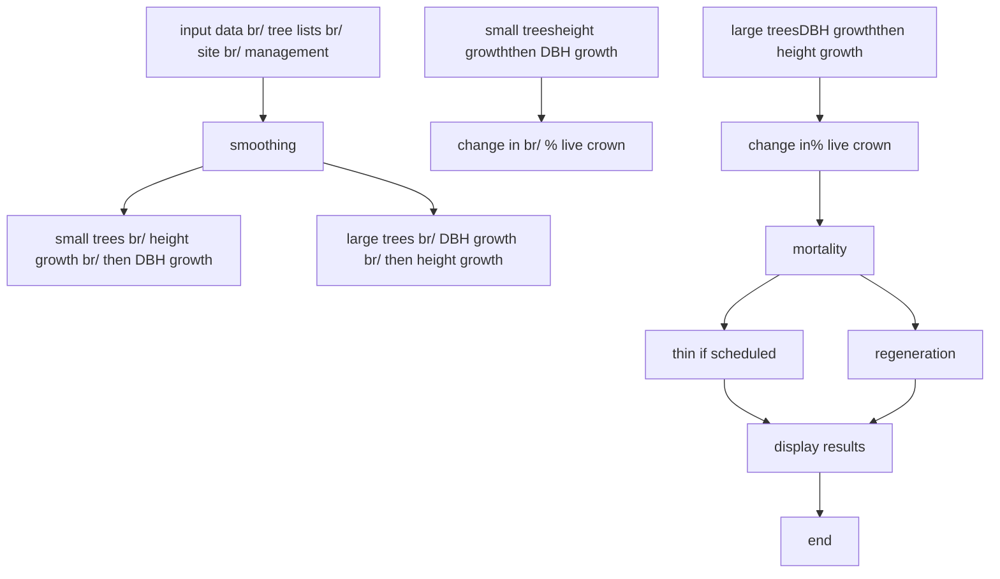
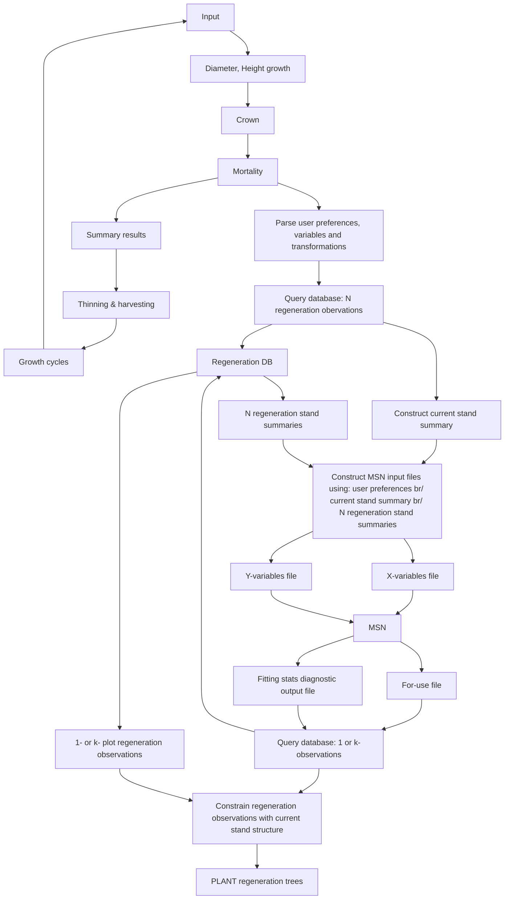

# **PrognosisBC**

# **Model and Current Research**

Abdel-Azim Zumrawi  
Research Branch, BC Ministry of Forests

Valerie LeMay and Peter Marshall  
Faculty of Forestry, UBC

June 29, 2005  
UNBC, Prince George

1

---

# **PrognosisBC Model**

- Single tree, Distance-independent GY model
- A variant of the USDA Forest Vegetation Simulator (FVS)
- Forecasts future stand conditions based on the expected growth and mortality of individual trees of mixed-species and/or multi-aged (complex stands)

2

---

# Main Features

- Can simulate
  - almost any form of harvesting, including thinning from below or above or by size class with or w/o species preferences
  - patterns of succession in complex stands (interaction between species and size classes)

- Has add-on components for insects and disease, fire, snag and CWD (e.g., root disease extension)

- Linkage to Stand Visualization System (SVS)

3

---

# Species Modeled

## Coniferous
- white pine
- lodgepole pine
- larch
- Douglas-fir
- grand fir
- W. hemlock
- W. redcedar
- Subalpine fir
- spruce
- Yellow Pine

## Hardwoods (version 3.0)
- aspen
- birch
- cottonwood

---

# Model Architecture & Geographic scope

## Ver. 2.0
- IDF
- ICH
- MS
- ESSF
- PP

## Ver. 3.0
- IDF
- ICH
- SBS

PrognosisBC application area

---

# **Input Data Requirements**

## **Required**

<u>Plot level information:</u>
Aspect, Slope, Elevation & BEC Site Series

<u>For every tree in the plot(s):</u>
- Species
- DBH

## **Recommended**
- Live crown %
- Subset of heights
- Subset of diameter increments
- Subset of height increments

6

---

# Model Output

## Graph stand level statistics

# Statistics Summary

| Year | SPH  |
| ---- | ---- |
| 2005 | 1230 |
| 2012 | 1160 |
| 2023 | 1095 |
| 2034 | 1035 |
| 2045 | 975  |
| 2056 | 920  |

density

**Print Chart**

**Apply**

**Close**

Print chart as:
- ☑ B+W
- ☐ Colour

Print chart to:
- ☑ Printer
- ☐ Clipboard

Chart Titles
- Top: Statistics Summary
- Left: SPH
- Bottom: Year

Markers
- ☑ Lines & Points
- ☐ Lines only
- ☐ Points Only

Chart grids:
- ☐ Vertical
- ☐ Horizontal

X Axis: Year  
Min:  

Y Axis: SPH  
Min:

---

# Model Output

## VIEWprog - [C:\WINDOWS\Data\fvs_game.mdb]

File Window Help

### Species Composition through...

**density: Density by Species**

| Calendar Year | FD  | PL  | SE  | BL | AT | Total |
| ------------- | --- | --- | --- | -- | -- | ----- |
| 2000          | 850 | 250 | 200 | 0  | 0  | 1300  |
| 2010          | 780 | 240 | 190 | 0  | 0  | 1210  |
| 2020          | 710 | 230 | 180 | 0  | 0  | 1120  |
| 2030          | 640 | 220 | 170 | 0  | 0  | 1030  |
| 2040          | 570 | 210 | 160 | 0  | 0  | 940   |
| 2050          | 600 | 200 | 150 | 0  | 0  | 950   |
| 2060          | 0   | 0   | 0   | 0  | 0  | 0     |

### Stand & Stock Tables: density

**DBH Classes**
Starting: 0
Class width: 10
# Of Classes: 10

**Reporting Years**

| Year |
| ---- |
| 2004 |
| 2014 |
| 2024 |
| 2034 |
| 2044 |

Select year[s] to display.

**Sample for year: 2004**

| DBH Class (cm) | AT | PL | BL | SE | FD |
| -------------- | -- | -- | -- | -- | -- |

| DBH Class (cm) | AT | PL  | BL  | SE  | FD  |
| -------------- | -- | --- | --- | --- | --- |
| 5              | 0  | 0   | 170 | 0   | 170 |
| 15             | 10 | 150 | 0   | 300 | 290 |
| 25             | 0  | 80  | 0   | 200 | 220 |
| 35             | 0  | 50  | 0   | 100 | 150 |
| 45             | 0  | 0   | 0   | 0   | 20  |

Edit Chart Titles:
Top: density: Density by Species
Left: Density (SPH)
Bottom: Calendar Year

Print as:
● B+W/
○ Colour

Grids:
☐ Vertical
☐ Horizontal

Print to:
● Printer
○ Clipboard

[signature]

---

# Limitations

- The spatial position of competing trees is ignored
  - Can only approximate the effects of clumped distributions or patch cuttings
  - Better early height growth and mortality models needed
  - Need better estimates of natural regeneration following disturbance: for current model release, user must input estimates
- Does not work well with aerial inventory
  - Requires stand table or individual tree list
- "Add-ons" – need better estimates of snags and regeneration following mountain pine beetle
- Geographic scope restricted.

9

---

# **Current Research Projects**

> Develop:
>
- Methods for estimating natural regeneration by species and height class based on site and overstory characteristic (more on this)
- Small tree height growth and mortality models
- Methods to estimate tree-lists from forest cover data (more on this)
- Methods to estimate regeneration following MPB
>
- Implement the best estimates in PrognosisBC for: ICHmw2, IDFdk1, dm2, dk2, dk3, and MSdk
- Extend the model to SBS (more on this)

10

---

# **Natural Regeneration and Tree-lists Using Imputation Methods**

Use known auxiliary variables to estimate variables of interest by

- Selecting a "nearest neighbor" from a database where both are measured (reference database)
- Selection is based on a measure of similarity between the variables of interest and the auxiliary variables e.g., Most Similar Neighbor – weighted Euclidean distance
- Allows for "retention" of variability in the estimated variables of interest, unlike regression methods

11

---

# Natural Regeneration and Tree-lists Using Imputation Methods

- For regeneration: residual stand structure, site ecology and disturbance history are auxiliary variables in the imputation
- For tree-list estimation: aerial variables from forest cover are used
- Results improve:
  - With a more comprehensive reference database
  - With a better relationship between auxiliary variables and variables of interest

12

---

# **Regeneration Imputation Example**

## For:
For Image

## Use:
Use Image

---

# Regeneration Model Components & Dynamic Linkages

## PrognosisBC Version 3

- Input
- Diameter, Height growth
- Crown
- Mortality
- Growth cycles
- Summary results
- Thinning & harvesting

## Regeneration System

- Parse user preferences, variables and transformations
- Query database: *N* regeneration observations
- Construct current stand summary
- Construct MSN input files using:
  - user preferences
  - current stand summary
  - *N* regeneration stand summaries
- Run MSN - user preferences
- Query database: 1 or *k*-observations
- Constrain regeneration observations with current stand structure
- PLANT regeneration trees

---

# Post-Harvest

SYS - p70_WADF_002

File Edit Display SYS options

**Stand=Plot: Year=1997 Post cutting**

| View      | Description                        |
| --------- | ---------------------------------- |
| 3D View   | Stand=Plot: Year=1997 Post cutting |
| Top View  | p70\_WADF\_002                     |
| Side View | Stand=Plot: Year=1997 Post cutting |

15

---

# +10 years (imputation)

## SVS - p70_WADF_003

**Stand=Plot: Year=2007 Beginning of cycle**

| View                                |
| ----------------------------------- |
| 3D Forest Model                     |
| Top-down Plot View (p70\_WADF\_003) |
| Side Profile View                   |

Stand=Plot: Year=2007 Beginning of cycle

First Previous Next Last

---

# Prognosis BC **+ 50 years**

## SVS - p70_WADF_007

**Stand=Plot: Year=2047 Beginning of cycle**

p70_WADF_007

| Year | Stand=Plot         |
| ---- | ------------------ |
| 2047 | Beginning of cycle |

7

---

# Extending the Model to SBS

Objective: Calibrate the main component models of PrognosisBC to allow its use in the SBS

- Radial increment models (PSP data)
- Juvenile height growth models for mixed-species stands in the SBS (TSP data)
- Non-catastrophic mortality models (PSP data)

18

---

# **Models**

> Large tree 10-year radial increment: function of tree size, vigour (CR), density (CCF), relative position (BAL), aspect and slope

> 5-year small tree height growth: function of tree height, relative position (CCF_large & CCF_small)

> Mortality: Tabular imputation (matrix indexed by tree size and stand density)

19

---

# Douglas-fir Radial Increment SBSmm

| DBH (cm.) | CR=0.9 CCF=125 | CR=0.9 CCF=175 | CR=0.9 CCF=225 | CR=0.5 CCF=125 | CR=0.5 CCF=175 | CR=0.5 CCF=225 | CR=0.1 CCF=125 | CR=0.1 CCF=175 | CR=0.1 CCF=225 |
| --------- | -------------- | -------------- | -------------- | -------------- | -------------- | -------------- | -------------- | -------------- | -------------- |
| 7.5       | 4.2            | 2.0            | 1.0            | 1.2            | 0.6            | 0.3            | 0.2            | 0.1            | 0.0            |
| 10.0      | 5.0            | 2.2            | 1.1            | 1.4            | 0.7            | 0.3            | 0.2            | 0.2            | 0.0            |
| 12.5      | 5.3            | 2.4            | 1.2            | 1.5            | 0.7            | 0.4            | 0.2            | 0.2            | 0.0            |
| 15.0      | 5.5            | 2.6            | 1.3            | 1.6            | 0.8            | 0.4            | 0.3            | 0.2            | 0.0            |
| 17.5      | 5.6            | 2.7            | 1.3            | 1.6            | 0.8            | 0.4            | 0.3            | 0.2            | 0.0            |
| 20.0      | 5.6            | 2.7            | 1.3            | 1.6            | 0.8            | 0.4            | 0.3            | 0.2            | 0.0            |
| 22.5      | 5.5            | 2.6            | 1.2            | 1.5            | 0.7            | 0.4            | 0.3            | 0.2            | 0.0            |
| 25.0      | 5.4            | 2.5            | 1.2            | 1.4            | 0.7            | 0.3            | 0.2            | 0.1            | 0.0            |
| 27.5      | 5.1            | 2.2            | 1.1            | 1.4            | 0.6            | 0.3            | 0.2            | 0.1            | 0.0            |
| 30.0      | 4.4            | 2.1            | 1.1            | 1.4            | 0.5            | 0.3            | 0.2            | 0.1            | 0.0            |
| 32.5      | 3.8            | 1.8            | 1.0            | 1.2            | 0.4            | 0.2            | 0.1            | 0.1            | 0.0            |
| 35.0      | 3.3            | 1.6            | 0.9            | 1.0            | 0.3            | 0.2            | 0.1            | 0.0            | 0.0            |
| 37.5      | 2.8            | 1.4            | 0.8            | 0.9            | 0.3            | 0.2            | 0.1            | 0.0            | 0.0            |
| 40.0      | 2.4            | 1.3            | 0.7            | 0.8            | 0.2            | 0.1            | 0.1            | 0.0            | 0.0            |
| 42.5      | 1.9            | 1.0            | 0.6            | 0.7            | 0.2            | 0.1            | 0.0            | 0.0            | 0.0            |
| 45.0      | 1.6            | 0.9            | 0.5            | 0.6            | 0.2            | 0.1            | 0.0            | 0.0            | 0.0            |
| 47.5      | 1.5            | 0.8            | 0.4            | 0.5            | 0.2            | 0.1            | 0.0            | 0.0            | 0.0            |
| 50.0      | 1.2            | 0.6            | 0.4            | 0.3            | 0.1            | 0.1            | 0.0            | 0.0            | 0.0            |

20

---

# Pine Radial Increment SBSmm

| DBH (cm.) | CR=0.60 BAL=0 | CR=0.40 BAL=1 | CR=0.25 BAL=2 | CR=0.16 BAL=3 | CR=0.10 BAL=4 |
| --------- | ------------- | ------------- | ------------- | ------------- | ------------- |
| 7.5       | 1.2           | 0.65          | 0.47          | 0.36          | 0.24          |
| 10.0      | 1.37          | 0.74          | 0.54          | 0.38          | 0.27          |
| 12.5      | 1.49          | 0.81          | 0.60          | 0.42          | 0.30          |
| 15.0      | 1.60          | 0.87          | 0.63          | 0.45          | 0.32          |
| 17.5      | 1.70          | 0.92          | 0.66          | 0.47          | 0.34          |
| 20.0      | 1.82          | 0.97          | 0.68          | 0.50          | 0.35          |
| 22.5      | 1.88          | 1.00          | 0.72          | 0.52          | 0.36          |
| 25.0      | 1.92          | 1.03          | 0.75          | 0.53          | 0.37          |
| 27.5      | 1.94          | 1.04          | 0.76          | 0.54          | 0.37          |
| 30.0      | 1.93          | 1.04          | 0.75          | 0.54          | 0.37          |
| 32.5      | 1.90          | 1.02          | 0.74          | 0.53          | 0.36          |
| 35.0      | 1.86          | 0.99          | 0.71          | 0.52          | 0.35          |
| 37.5      | 1.79          | 0.95          | 0.69          | 0.50          | 0.34          |
| 40.0      | 1.66          | 0.89          | 0.64          | 0.48          | 0.33          |
| 42.5      | 1.55          | 0.84          | 0.59          | 0.45          | 0.31          |
| 45.0      | 1.43          | 0.77          | 0.56          | 0.43          | 0.29          |
| 47.5      | 1.30          | 0.69          | 0.49          | 0.37          | 0.26          |
| 50.0      | 1.15          | 0.62          | 0.44          | 0.33          | 0.22          |

21

---

# Spruce small tree HTG SBSdw1&2

| Height (m) | CCFL=225 | CCFL=150 | CCFL=100 |
| ---------- | -------- | -------- | -------- |
| 0.13       | 18.5     | 21.5     | 23.0     |
| 0.63       | 20.0     | 22.5     | 27.0     |
| 1.13       | 23.0     | 27.0     | 36.0     |
| 1.63       | 26.0     | 33.0     | 46.0     |
| 2.13       | 29.0     | 39.0     | 57.0     |
| 2.63       | 33.0     | 46.0     | 71.0     |
| 3.13       | 37.0     | 55.0     | 84.0     |
| 3.63       | 42.0     | 63.0     | 97.0     |
| 4.13       | 47.0     | 71.0     | 109.0    |
| 4.63       | 52.0     | 80.0     | 120.0    |
| 5.13       | 58.0     | 89.0     | 129.0    |
| 5.63       | 63.0     | 98.0     | 136.0    |
| 6.13       | 69.0     | 106.0    | 140.0    |
| 6.63       | 75.0     | 113.0    | 144.0    |
| 7.13       | 80.0     | 119.0    | 147.0    |
| 7.63       | 86.0     | 125.0    | 150.0    |
| 8.13       | 95.0     | 133.0    | 152.0    |

---

# **Future Research Projects**

- Model Validation (FSP)
  - test performance and integrity of all components including regeneration imputation (ICH, IDF, SBS)
  - tree-list imputation not implemented
- **MPB Linkages (MPBI):**
  - Performance and linkages to the Westwide MPB model
  - Modeling Natural Regeneration Following Mountain Pine Beetle Attacks

23

---

# Acknowledgements and Websites

**Former and current UBC Visiting Scientists, Research Associates and Graduate Students:**

Dr. H. Temesgen, Badre Hassani, Cornel Lencar, Celine Boisvenue, Dr. S. Akindale, Stephanie Ortlepp, Paul Thony, Rene Martin

**Don Robinson, ESSA Technologies**

**Funding by FRBC, FII and FIA (FSP) and MPBI, and NSERC**

**Support of all Collaborators in Government and Industry**

<u>http://www.for.gov.bc.ca/hre/gymodels/progbc/index.htm</u>

<u>www.forestry.ubc.ca/PrognosisBC</u>

24
