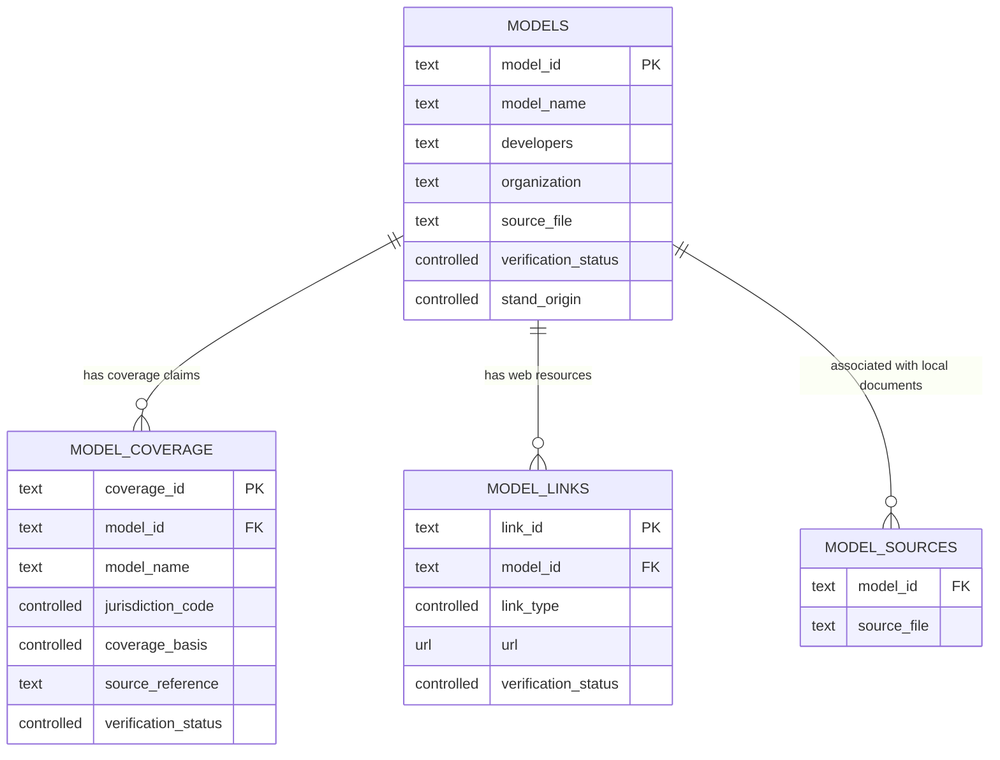
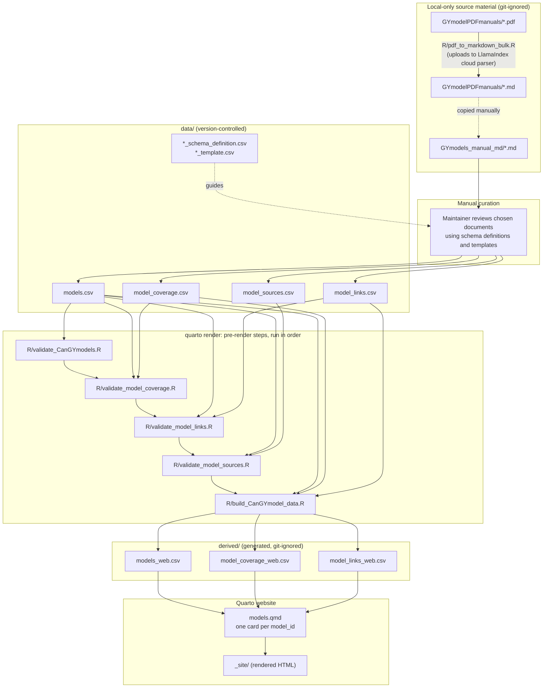

# Registry data model and pipeline

This document describes the CSV files that make up the Canadian Forest Growth
& Yield Model Registry, how they link to one another, what every column means,
and how the R scripts and Quarto site turn them into the published catalogue.

It reflects the schema as currently defined in `data/*_schema_definition.csv`
and enforced by the scripts in `R/`. Where the schema states a rule that no
script yet enforces, this is called out explicitly.

## Contents

1. [File inventory](#1-file-inventory)
2. [How the files link](#2-how-the-files-link)
3. [Column definitions](#3-column-definitions)
4. [Pipeline workflow](#4-pipeline-workflow)
5. [What each R script does](#5-what-each-r-script-does)
6. [Validation coverage](#6-validation-coverage)
7. [Known gaps](#7-known-gaps)

---

## 1. File inventory

| File | Role | Edited by | Version-controlled |
| --- | --- | --- | --- |
| `data/models.csv` | Model summaries, **one row per model**, keyed by `model_id` | Maintainers | Yes |
| `data/model_coverage.csv` | Geographic applicability claims, one row per model × jurisdiction claim | Maintainers | Yes |
| `data/model_links.csv` | Web resources (websites, manuals, software, publications), one row per link | Maintainers | Yes |
| `data/model_sources.csv` | Associations between a model and local Markdown source documents | Maintainers | Yes |
| `data/*_schema_definition.csv` | Column definitions, data types, required flags, allowed values, examples | Maintainers | Yes |
| `data/*_template.csv` | Empty header rows for starting a new file or record | Maintainers | Yes |
| `derived/models_web.csv` | Website copy of `models.csv` | `build_CanGYmodel_data.R` | No (git-ignored) |
| `derived/model_coverage_web.csv` | Website copy of `model_coverage.csv` | `build_CanGYmodel_data.R` | No (git-ignored) |
| `derived/model_links_web.csv` | Website copy of `model_links.csv` | `build_CanGYmodel_data.R` | No (git-ignored) |

`model_sources.csv` has a schema definition but no template file.

`CanGrowthModelsWikiPage.csv` was a one-off seed file and is **retired**, not a
pipeline input or a planned integration. It is git-ignored wherever it occurs.
Previously imported information retains its Wikipedia provenance, citations,
and review status without referring to the local CSV as a source document.

---

## 2. How the files link

### Keys

| Key | Defined in | Unique? | Meaning |
| --- | --- | --- | --- |
| `model_id` | `models.csv` | Yes | One model. All other files reference this stable identifier. |
| `coverage_id` | `model_coverage.csv` | Yes | One geographic applicability claim |
| `link_id` | `model_links.csv` | Yes | One web resource |
| `(model_id, source_file)` | `model_sources.csv` | Yes, as a pair | One model-to-document association |

`models.csv` is the master model list, with one row and one website card per
`model_id`. IDs do not contain source-record suffixes. A model can have multiple
coverage claims, links, and document associations in the other files.

### Relationship diagram



The diagram shows keys and selected fields; full column lists are in
[section 3](#3-column-definitions).

### Relationship rules

| Relationship | Cardinality | Enforced by | Behaviour on failure |
| --- | --- | --- | --- |
| `model_coverage.model_id` → `models.model_id` | Many claims to one model | `validate_model_coverage.R`; `build_CanGYmodel_data.R` | **Warning** in the validator; **error** in the build |
| `model_links.model_id` → `models.model_id` | Many links to one model | `validate_model_links.R`; `build_CanGYmodel_data.R` | Error |
| `model_sources.model_id` → `models.model_id` | Many documents to one model | `validate_model_sources.R` | Error |
| `model_coverage.model_name` ↔ `models.model_name` | Duplicated display value | Not enforced | Values can drift apart |
| `model_sources.source_file` ↔ `models.source_file` | Same kind of value (Markdown filename) | Not enforced, by design | An association does not populate or verify `models.source_file` |

### Design principles

- **Claims stay separate.** Model capabilities (`models.csv`), geographic
  applicability (`model_coverage.csv`), and links (`model_links.csv`) are
  kept in separate files and are not reconciled against one another.
- **One row per model.** Maintainers update a single summary in `models.csv`.
  Preserve citations, uncertainties, disagreements, and version-specific
  qualifications in the source fields and notes rather than creating duplicate
  model rows. Associate additional documents in `model_sources.csv`.
- **People and organizations are separate.** `developers` lists documented
  individual contributors; `organization` lists documented supporting
  organizations. Publication authors and publishers do not, by themselves,
  establish these roles.
- **Association is not verification.** A row in `model_sources.csv` records
  that a document relates to a model; it does not state which claims, if any,
  the document supports.
- **Unknown is explicit.** Controlled fields provide `unknown` rather than
  allowing a guessed value.

---

## 3. Column definitions

Conventions used in all files:

- **Multi-value fields** separate values with a semicolon (`;`), e.g. `BC;AB`.
- **Controlled** fields accept only the listed values.
- **Required** means the schema requires a value. [Section 6](#6-validation-coverage)
  shows which required rules are actually checked.
- `verification_status` is always either `unverified` (entered but not yet
  checked by a maintainer) or `verified` (checked by a maintainer).

At the maintainer's direction, species lists in both `models.species` and
`model_coverage.species_scope` expand `Eastern SPF` to
`Balsam fir;black spruce;red spruce;white spruce;jack pine` and `Western SPF`
to `Spruce;Pine;Fir`. Other species entries and the original review status
are retained; expanding a label does not independently verify a claim.

### 3.1 `data/models.csv`

One summary row per model. Source fields can identify a main supporting document;
additional local document associations belong in `model_sources.csv`.

| Column | Type | Required | Definition | Allowed values | Example |
| --- | --- | --- | --- | --- | --- |
| `model_id` | text | Yes | Unique, stable lowercase identifier (slug) for the model; used to join all other files. No source-record suffix. | — | `vdyp` |
| `model_name` | text | Yes | Common name or acronym of the model. | — | `VDYP7` |
| `developers` | text | No | Individuals documented as contributing to model development. Multi-value; blank if not documented. | — | `Mathieu Fortin; Luc Langevin` |
| `organization` | text | No | Organization(s) documented as supporting model development. Multi-value; blank if not documented. | — | `Direction de la recherche forestière (DRF), Gouvernement du Québec` |
| `jurisdictions` | text | No | Provinces or territories where **this source** says the model applies. Multi-value. Separate from the structured claims in `model_coverage.csv`. | `BC`, `AB`, `SK`, `MB`, `ON`, `QC`, `NB`, `NS`, `PE`, `NL`, `YT`, `NT`, `NU`, `Canada`, `other` | `BC` |
| `model_type` | controlled | No | Broad model class, as stated in the source. | `whole_stand`, `individual_tree`, `diameter_class`, `hybrid`, `other`, `unknown` | `whole_stand` |
| `species` | text | No | Species or species groups covered. Multi-value. Free text, not a standardized taxonomy. | — | `Pli;Fdi;Sx` |
| `minimum_inputs` | text | No | Minimum inputs needed to initialize or run the model, rather than all optional parameters. Multi-value; blank if not documented. | — | `site index;species;stem density` |
| `outputs` | text | No | Key model outputs. Multi-value. | — | `volume;basal area` |
| `management_options` | text | No | Silvicultural interventions the source says the model can represent. Multi-value. Blank if the source does not say. | — | `thinning;fertilization` |
| `other_features` | text | No | Other processes the source says are represented, such as mortality, regeneration, climate, or disturbance. Multi-value. Blank if not stated. | — | `mortality;climate` |
| `status` | controlled | No | Lifecycle status, only if the source states it. | `active`, `maintained`, `legacy`, `archived`, `unknown` | `unknown` |
| `source_file` | text | No | Optional filename of a supporting local Markdown document. Use `model_sources.csv` for additional documents. | — | `vdyp7_manual.md` |
| `source_citation` | text | No | Citation (authors, year, title) supporting the model summary. | — | — |
| `source_year` | integer | No | Publication year of the cited source. | — | `2020` |
| `verification_status` | controlled | Yes | Review state of this row. | `unverified`, `verified` | `unverified` |
| `notes` | text | No | Uncertainties or ambiguities. Values the source does not state must not be guessed. | — | — |
| `stand_origin` | controlled | Yes | Stand context the model represents. `managed` covers post-harvest stands regenerated by planting or natural regeneration. | `natural_origin`, `managed`, `both`, `unknown` | `managed` |

### 3.2 `data/model_coverage.csv`

One row per geographic applicability claim for a model.

| Column | Type | Required | Definition | Allowed values | Example |
| --- | --- | --- | --- | --- | --- |
| `coverage_id` | text | Yes | Unique identifier for this coverage claim. | — | `mgm_ab` |
| `model_id` | text | Yes | Model identifier; should match `models.model_id`. | — | `mgm` |
| `model_name` | text | Yes | Model display name, repeated here for review and display. | — | `MGM` |
| `jurisdiction_code` | controlled | Yes | Single province or territory the claim applies to. Use `unknown` when the evidence states no geography. | `AB`, `BC`, `SK`, `MB`, `ON`, `QC`, `NB`, `NS`, `PE`, `NL`, `YT`, `NT`, `NU`, `unknown` | `AB` |
| `region_detail` | text | No | Sub-provincial or ecological qualifier. Must be used whenever the claim covers less than the whole jurisdiction. | — | `North-eastern BC` |
| `coverage_basis` | controlled | Yes | How the model relates to the jurisdiction. Multi-value. `calibrated_for`: fitted to data from it; `intended_for`: designed for use in it; `validated_in`: tested against data from it. | `calibrated_for`, `intended_for`, `validated_in` | `calibrated_for;intended_for` |
| `stand_scope` | text | No | Stand conditions stated for this model in this jurisdiction. | — | `Pure and mixed-species stands` |
| `species_scope` | text | No | Species or species groups stated for this claim. Multi-value. | — | `Lodgepole pine;white spruce` |
| `validation_evidence` | text | No | Validation datasets or projects supporting the claim. | — | `Alberta PSPs` |
| `source_reference` | text | Yes | Provenance of the claim. Replace user-summary references with documentary citations when available. | — | `User-provided summary (2026-10-06)` |
| `verification_status` | controlled | Yes | Review state of the claim. | `unverified`, `verified` | `unverified` |
| `notes` | text | No | Qualifications, unresolved geography, or scope details. | — | `WESBOGY PSP geography not specified; do not map this row` |

### 3.3 `data/model_links.csv`

One row per web resource.

| Column | Type | Required | Definition | Allowed values | Example |
| --- | --- | --- | --- | --- | --- |
| `link_id` | text | Yes | Unique identifier for this link. | — | `mgm_official_website` |
| `model_id` | text | Yes | Model identifier; must match `models.model_id`. | — | `mgm` |
| `link_type` | controlled | Yes | Kind of resource. On the website, `official_website`, `software`, and `source_code` are listed under *Model websites and downloads*; the others under *Related documents and webpages*. | `official_website`, `manual`, `software`, `source_code`, `publication`, `other` | `official_website` |
| `title` | text | Yes | Text shown for the hyperlink. | — | `MGM official website` |
| `url` | url | Yes | Public address beginning with `http://` or `https://`. | — | `https://mgm.ualberta.ca/` |
| `accessed_date` | date | No | Date the link was last checked. | `YYYY-MM-DD` | `2026-10-06` |
| `verification_status` | controlled | Yes | Whether a maintainer has checked the link. | `unverified`, `verified` | `unverified` |
| `notes` | text | No | Link context, including any version-specific applicability, and verification notes. | — | `URL supplied by registry maintainer` |

### 3.4 `data/model_sources.csv`

One row per model-to-document association.

| Column | Type | Required | Definition | Allowed values | Example |
| --- | --- | --- | --- | --- | --- |
| `model_id` | text | Yes | Model identifier; must match `models.model_id`. | — | `mgm` |
| `source_file` | text | Yes | Filename only (no folder path) of a local Markdown document associated with the model. The document itself is kept in the local-only `GYmodels_manual_md/` folder. | Must end in `.md` | `MGM21_Best_Practices_Feb_28_22.md` |

### 3.5 Schema definition files

All four `*_schema_definition.csv` files share one structure: one row per
column in the data file they describe.

| Column | Definition |
| --- | --- |
| `field_name` | Column name in the data file |
| `data_type` | `text`, `controlled`, `integer`, `date`, or `url` |
| `required` | `yes` or `no` |
| `description` | What the column means and how to fill it |
| `allowed_values` | Permitted values separated by `\|`, or a format such as `YYYY-MM-DD`; blank if unrestricted |
| `example` | Example value |

### 3.6 `derived/*_web.csv`

Each derived file has exactly the same columns as its `data/` counterpart.
The build script copies rows without transforming them.

## 4. Pipeline workflow



Dashed arrows are manual steps or planned connections, not scripted ones.

### Step by step

1. **Convert manuals (optional).** `pdf_to_markdown_bulk.R` sends each PDF in
   `GYmodelPDFmanuals/` to the LlamaIndex cloud parsing service and saves the
   returned Markdown beside the PDF. Moving the files into
   `GYmodels_manual_md/` is a manual step.
2. **Curate.** A maintainer reads explicitly chosen Markdown documents and
   updates one summary row per model, with separate coverage claims, links,
   and document associations in the four `data/` files. Follow the schema
   definitions and retain provenance. New summaries, claims, and links start
   as `unverified`; document associations do not establish verification.
3. **Validate.** `quarto render` first runs the four validators. Any error
   stops the render.
4. **Build.** `build_CanGYmodel_data.R` re-checks that coverage and link rows
   refer to known models, then copies the three website files into `derived/`.
   `model_sources.csv` is validated but not published.
5. **Render.** `models.qmd` reads the `derived/` files and produces one card
   per model row. Each card shows the model summary, separate developers and
   organization fields, provenance, coverage claims, and links, with review
   status. Browser-side filters
   use `model_type`, `stand_origin`, `jurisdiction_code`, and a keyword search
   over `species` and `species_scope`.

To run the pipeline from the project root:

```powershell
quarto render
```

or step by step:

```powershell
Rscript R/validate_CanGYmodels.R
Rscript R/validate_model_coverage.R
Rscript R/validate_model_links.R
Rscript R/validate_model_sources.R
Rscript R/build_CanGYmodel_data.R
quarto render
```

All scripts use paths relative to the project root.

---

## 5. What each R script does

| Script | Reads | Writes | Run by | Purpose |
| --- | --- | --- | --- | --- |
| `validate_CanGYmodels.R` | `models.csv` | Console summary | Quarto pre-render | Checks required columns including `developers`, `organization`, and `minimum_inputs`, unique and non-blank `model_id`, non-blank `stand_origin`, and controlled values; prints model count and counts by `status` and `model_type` |
| `validate_model_coverage.R` | `model_coverage.csv`, `models.csv` | Console summary | Quarto pre-render | Checks required columns and values, unique `coverage_id`, and controlled values; warns about unknown `model_id` |
| `validate_model_links.R` | `model_links.csv`, `models.csv` | Console summary | Quarto pre-render | Checks required columns and values, unique `link_id`, `link_type`, URL scheme, and known `model_id` |
| `validate_model_sources.R` | `model_sources.csv`, `models.csv` | Console summary | Quarto pre-render | Checks required values, unique model–document pairs, Markdown filenames without paths, and known `model_id`; does not open the documents |
| `build_CanGYmodel_data.R` | `models.csv`, `model_coverage.csv`, `model_links.csv` | `derived/*_web.csv` | Quarto pre-render | Stops on unknown `model_id` in coverage or links; copies files unchanged |
| `pdf_to_markdown_bulk.R` | `GYmodelPDFmanuals/*.pdf`, `api_key.txt` | `GYmodelPDFmanuals/*.md` | Manual | Converts PDF manuals to Markdown via a cloud service |
| `coverage_type.R` | Expects in-memory objects `regions` and `model_coverage` | `data/model_coverage.geojson` | Not run | Unfinished map prototype; see [section 7](#7-known-gaps) |
| `pdf_to_markdown_magplot.R` | A MAGPlot data dictionary PDF in another project | Markdown beside that PDF | Manual | Local PDF-to-Markdown conversion for a different project; not part of this pipeline |

---

## 6. Validation coverage

✅ checked (error) · ⚠️ checked (warning only) · — not checked

| Rule | `models` | `model_coverage` | `model_links` | `model_sources` |
| --- | --- | --- | --- | --- |
| Required columns present | ✅ | ✅ | ✅ | ✅ |
| Required values non-blank | Partial | ✅ | ✅ | ✅ |
| Primary key unique | ✅ `model_id` | ✅ `coverage_id` | ✅ `link_id` | ✅ pair |
| Controlled values valid | ✅ `model_type`, `status`, `stand_origin`, `verification_status` | ✅ `jurisdiction_code`, `coverage_basis`, `verification_status` | ✅ `link_type`, `verification_status` | n/a |
| `model_id` exists in `models.csv` | n/a | ⚠️ validator, ✅ build | ✅ | ✅ |
| Format checks | — | — | ✅ URL scheme | ✅ `.md`, no path |

Details for `models.csv`:

- Blank values are rejected for `model_id`, `stand_origin`, and
  `verification_status`. Blank `model_name` is not checked, although the schema
  marks it required. `developers`, `organization`, `minimum_inputs`, and
  `source_file` must exist as columns but may have blank values.
- `jurisdictions` allowed values and `source_year` integer type are not checked.

Other unchecked rules:

- `model_links.accessed_date` format.
- Consistency of `model_name` across files.

---

## 7. Known gaps

- **Map prototype incomplete.** `coverage_type.R` depends on objects that no
  script creates, joins on a `region` column that `model_coverage.csv` does not
  have, and is not in the pre-render list.
- **Unquoted comma in a schema file.** The `notes` row in
  `model_coverage_schema_definition.csv` has an unquoted comma in its
  description (`Qualifications, unresolved geography, or scope details.`), so
  CSV readers will see an extra column on that row.
- **Inconsistent missing-model handling.** An unknown `model_id` in
  coverage is a warning in its validator but an error in the build.
- **Cloud upload in the PDF converter.** `pdf_to_markdown_bulk.R` uploads
  manuals to an external service, while the project rules treat the manuals
  as local-only. Confirm licensing before using it on restricted documents.
- **No automated tests yet.** `tests/` currently contains only a README.
