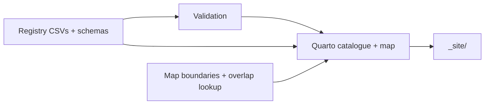

# Registry guide: data model and pipeline

Technical reference for the registry data, validation, and local site build.
For submissions, CSV edits, and maintainer review, use
[CONTRIBUTING.md](../CONTRIBUTING.md).

## Contents

1. [Files and keys](#1-files-and-keys)
2. [Column definitions](#2-column-definitions)
3. [How the pipeline works](#3-how-the-pipeline-works)
4. [Validation coverage](#4-validation-coverage)
5. [Known limits and release follow-up](#5-known-limits-and-release-follow-up)

---

## 1. Files and keys

| File | Role |
| --- | --- |
| [models.csv](../data/models.csv) | One brief summary per model, keyed by `model_id`. |
| [model_coverage.csv](../data/model_coverage.csv) | Model/province/territory coverage, with optional region and ecozones; drives the map. |
| [model_links.csv](../data/model_links.csv) | One public web resource per row. |
| [Canada boundaries](../data/geospatial/canada/) | Province/territory boundaries and their licence notice. |
| [Ecozone boundaries](../data/geospatial/ecozones/) | Source and prepared boundaries, province/ecozone overlap lookup, and their licence notice. |

The Quarto pages read `data/` directly; there is no generated `derived/` copy.
Local source manuals used while gathering information are kept outside the
repository and are not part of the pipeline.

| Key | Defined in | Meaning |
| --- | --- | --- |
| `model_id` | `models.csv` | One model; unique, stable lowercase slug. Other tables reference it. |
| `coverage_id` | `model_coverage.csv` | One model/jurisdiction(/region) row; unique. |
| `link_id` | `model_links.csv` | One web resource; unique. |

## 2. Column definitions

The schema files are the **single source of truth** for columns, types, required
fields, allowed values, and examples. The validator reads them directly; this
guide does not duplicate their tables.

| Table | Schema |
| --- | --- |
| Models | [models_schema_definition.csv](../data/models_schema_definition.csv) |
| Coverage | [model_coverage_schema_definition.csv](../data/model_coverage_schema_definition.csv) |
| Links | [model_links_schema_definition.csv](../data/model_links_schema_definition.csv) |

### Entry conventions

- Save UTF-8 CSVs; preserve headers, quote cells containing commas, and separate
  multi-value fields with `;`.
- Keep one row per model. Put version-specific qualifications in `notes` or link titles.
- Keep original `developers`, supporting `organization`, and later `contributors`
  separate; do not infer them from publication authors.
- Use expanded species names rather than `Eastern SPF` or `Western SPF`.
- Use `unknown` for undetermined `management_context`, `availability`, and
  `programming_language`. Other optional fields may stay blank; use `unknown`
  only where the schema allows it.
- Put Canadian province/territory codes in `jurisdiction_code`; sub-regions,
  ecosystems, and US states belong in `region_detail`.
- Set `ecozones` only when supported by the model's documentation. Blank means
  province-wide or unknown, not confirmed coverage of every ecozone.
- Choose `link_type` by purpose: `model_download` obtains the model,
  `run_tool` helps run it, and `source_code` is the model's own code.
  GitHub hosting is detected from the URL, not the type.
- Dates use `YYYY-MM-DD`.

---

## 3. How the pipeline works



- [_quarto.yml](../_quarto.yml) runs
  [validate_registry.R](../scripts/validate_registry.R) before rendering;
  validation errors stop the build.
- [models.qmd](../models.qmd) builds the filtered catalogue;
  [map.qmd](../map.qmd) builds the province/territory and ecozone map.
- [prepare_ecozones.R](../scripts/prepare_ecozones.R) prepares ecozone boundaries
  and the province/ecozone overlap lookup. Re-run only when the source,
  excluded ecozones, or simplification tolerance changes. The three largely
  unforested Arctic ecozones are excluded.
- CI is configured to run tests and render the site on pushes and pull requests.

### Running the checks

Install R, Quarto, and the R packages listed in [DESCRIPTION](../DESCRIPTION).
From the project root, run these in a terminal (including RStudio's Terminal):

```powershell
Rscript scripts\validate_registry.R
Rscript tests\testthat.R
quarto render
```

All three must pass. Open `_site/index.html` and inspect the affected card and map.
If `Rscript` or `quarto` is not recognized, add its installation's `bin` folder
to the terminal's PATH. Do not edit or commit `_site/` or `.quarto/`.

---

## 4. Validation coverage

Every column in every table is checked against its `*_schema_definition.csv`.

| Rule | Severity |
| --- | --- |
| Required columns present; no columns missing from or beyond the schema | Error |
| Fields marked `required = yes` are non-blank | Error |
| `integer`, `date` (`YYYY-MM-DD`), and `url` (`http(s)://`) types | Error |
| `controlled` values are in the allowed list (multi-value cells split on `;`) | Error |
| Primary key unique (`model_id`, `coverage_id`, `link_id`) | Error |
| `model_id` in coverage and links exists in `models.csv` | Error |
| Models with no row in model_links | Warning |
| Models with no link whose link_type is one of official_website, model_download, source_code | Warning |
| Models marked `availability = public_download` with no `model_download` link | Warning |
| Models with no row in model_coverage (not shown on the map) | Warning |

Not checked: link reachability, or whether a value is accurate or current.
A passing validation is not a factual review.

---

## 5. Known limits and release follow-up

- **Map geography is jurisdiction-level, plus an ecozone view.** Regions and
  US states stay in `region_detail` and are not drawn. The ecozone view
  (`map.qmd`) shows a province-wide model on every ecozone its province
  overlaps, per `data/geospatial/ecozones/province_ecozones.csv`; this may
  over-represent coverage where the model documentation did not actually
  intend the whole province. `R/geo.R`'s `check_coverage_ecozones()` flags
  `ecozones` values inconsistent with the jurisdiction's overlap but is only
  exercised by `tests/testthat/test-ecozones.R` so far; wiring it into
  `scripts/validate_registry.R` is a follow-up.
- **Wikipedia-seeded entries.** Some early entries were seeded from a Wikipedia
  page (CC BY-SA); review reuse requirements before public release.
- **Release checks.** Confirm CI passes on GitHub and test the contribution
  flow before public release. Deployment requires maintainer approval.
- **No tests of rendered pages.** Tests cover the data contract, not the
  catalogue filters or map popups.

See the [project plan](PROJECT_PLAN.md) for remaining work and
[README licence information](../README.md#copyright-and-license) for project and
third-party terms. Keep the licence notices with the bundled geospatial files.
