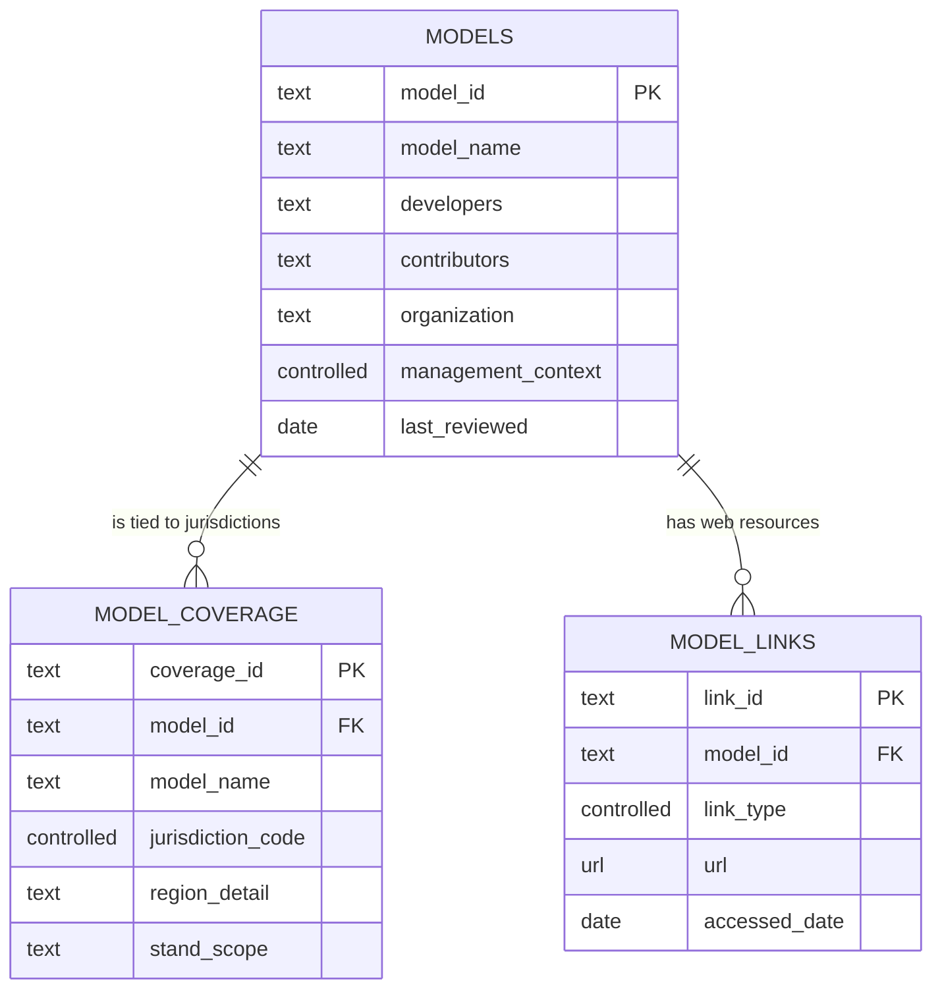
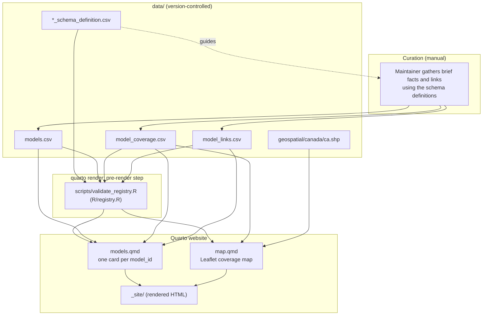

# Registry guide: data model, pipeline, and how to contribute

This is the single reference for the Canadian Forest Growth & Yield Model
Registry. It covers what the data files mean, how the validator and Quarto site
use them, how maintainers update them, and how collaborators and (once the
repository is public) members of the public can propose additions and changes.

The registry is a **pointer, not an authoritative source**. Entries are brief and
general, and links lead users to each model's own website and repositories for
current details. Models change over time and the registry is updated only
periodically, so keeping the schema general reduces the chance of stating
outdated or inaccurate facts.

## Contents

1. [Files and keys](#1-files-and-keys)
2. [Column definitions](#2-column-definitions)
3. [How the pipeline works](#3-how-the-pipeline-works)
4. [Maintainer workflow: editing the CSVs](#4-maintainer-workflow-editing-the-csvs)
5. [Contributing](#5-contributing)
6. [Validation coverage](#6-validation-coverage)
7. [Known gaps and open decisions](#7-known-gaps-and-open-decisions)

---

## 1. Files and keys

| File | Role | Edited by |
| --- | --- | --- |
| `data/models.csv` | Brief model summaries, **one row per model**, keyed by `model_id` | Maintainers |
| `data/model_coverage.csv` | Province/territory (with optional region) each model is tied to; drives the map | Maintainers |
| `data/model_links.csv` | Links to websites, repositories, software, manuals, and publications, one row per link | Maintainers |
| `data/*_schema_definition.csv` | Column definitions, data types, required flags, allowed values, examples; **read by the validator** | Maintainers |
| `data/geospatial/canada/` | Canada province/territory boundary shapefile and Simplemaps license notice | Maintainers |

The Quarto pages read `data/` directly; there is no generated `derived/` copy.
Local source manuals used while gathering information are kept outside the
repository and are not part of the pipeline.

| Key | Defined in | Meaning |
| --- | --- | --- |
| `model_id` | `models.csv` | One model; unique, stable lowercase slug. Other tables reference it. |
| `coverage_id` | `model_coverage.csv` | One model/jurisdiction(/region) row; unique. |
| `link_id` | `model_links.csv` | One web resource; unique. |



### Design principles

- **Pointer, not source.** Keep entries brief and general; rely on links for
  detail. Do not reproduce detail from manuals or publications.
- **One row per model.** Version-specific qualifications go in `notes` or in
  labelled links rather than in duplicate model rows.
- **People and organizations are separate.** `developers` are the original
  developers; `organization` is the organization that supported or directed
  development; `contributors` are individuals or organizations that added to
  later development. Do not infer these from publication authors or publishers.
- **Jurisdictions are provinces and territories only.** Sub-regions, specific
  areas, ecosystems, and US states go in `model_coverage.region_detail`. Every
  model is tied to a Canadian province or territory for the map, with optional
  extra detail.
- **Unknown is explicit where allowed.** Controlled fields that need a
  placeholder provide `unknown`; other optional fields may be left blank.

---

## 2. Column definitions

Conventions: **multi-value fields** separate values with a semicolon (`;`), e.g.
`BC;AB`; **controlled** fields accept only the listed values; **required** means
the validator rejects blank values. Species lists use expanded names rather than
`Eastern SPF` (`Balsam fir;black spruce;red spruce;white spruce;jack pine`) or
`Western SPF` (`Spruce;Pine;Fir`).

### 2.1 `data/models.csv`

| Column | Type | Required | Definition | Allowed values | Example |
| --- | --- | --- | --- | --- | --- |
| `model_id` | text | Yes | Unique, stable lowercase identifier (slug); joins the other tables. | — | `vdyp` |
| `model_name` | text | Yes | Common name or acronym. | — | `VDYP7` |
| `developers` | text | No | Original developers (individuals). Multi-value. | — | `Mathieu Fortin; Luc Langevin` |
| `contributors` | text | No | Individuals or organizations that added to later development. Multi-value. | — | `Jane Doe; University of Alberta` |
| `organization` | text | No | Organization(s) that supported or directed development. Multi-value. | — | `BC Ministry of Forests` |
| `jurisdictions` | controlled | No | Canadian provinces/territories where the model is used or applicable. Multi-value; provinces and territories only. | `AB`, `BC`, `SK`, `MB`, `ON`, `QC`, `NB`, `NS`, `PE`, `NL`, `YT`, `NT`, `NU` | `BC;AB` |
| `model_type` | controlled | No | Broad model class. | `whole_stand`, `individual_tree`, `diameter_class`, `hybrid`, `other`, `unknown` | `whole_stand` |
| `species` | text | No | Species or groups covered (general summary). Multi-value. | — | `Balsam fir;black spruce` |
| `minimum_inputs` | text | No | Minimum inputs to run the model. Multi-value. | — | `site index;species` |
| `outputs` | text | No | Key outputs. Multi-value. | — | `volume;basal area` |
| `management_options` | text | No | Management actions the model can represent. Multi-value. | — | `thinning;fertilization` |
| `other_features` | text | No | Other represented features (mortality, regeneration, climate, disturbance). Multi-value. | — | `mortality;climate` |
| `programming_language` | text | No | Programming language(s) the model is written in. Multi-value. Use `unknown` until determined. | — | `Fortran;R` |
| `management_context` | controlled | Yes | Stands the model is intended for. `unmanaged` = natural-origin or fire-origin stands, or stands harvested long ago and now old; `managed` = harvested or replanted stands; `unmanaged_managed` = both. Use `unknown` until determined. | `unmanaged`, `managed`, `unmanaged_managed`, `unknown` | `managed` |
| `notes` | text | No | Free-text qualifications or uncertainties. | — | — |
| `last_reviewed` | date | No | Date the maintainer last reviewed this entry. | `YYYY-MM-DD` | `2026-10-19` |

### 2.2 `data/model_coverage.csv`

One row per model and province/territory (and optionally region). The map is
built from this table.

| Column | Type | Required | Definition | Allowed values | Example |
| --- | --- | --- | --- | --- | --- |
| `coverage_id` | text | Yes | Unique identifier for this row. | — | `mgm_ab` |
| `model_id` | text | Yes | Must match `models.model_id`. | — | `mgm` |
| `model_name` | text | Yes | Display name for map popups; keep identical to `models.model_name`. | — | `MGM` |
| `jurisdiction_code` | controlled | Yes | Canadian province/territory the model is tied to. | same codes as `jurisdictions` | `AB` |
| `region_detail` | text | No | Sub-region, specific area, ecosystem or ecoregion, or US state. Blank for province-wide coverage. | — | `BC_interior` |
| `stand_scope` | text | No | Stand conditions the model is applied to in this jurisdiction. | — | `Pure and mixed-species stands` |

### 2.3 `data/model_links.csv`

One row per link. Links are how users find current model details. All of a
model's links appear together on its card under *Model websites, related
documents/tools and downloads*, each labelled with its type.

| Column | Type | Required | Definition | Allowed values | Example |
| --- | --- | --- | --- | --- | --- |
| `link_id` | text | Yes | Unique identifier for this link. | — | `mgm_official_website` |
| `model_id` | text | Yes | Must match `models.model_id`. | — | `mgm` |
| `link_type` | controlled | Yes | Kind of resource. | `official_website`, `manual`, `software`, `source_code`, `publication`, `other` | `official_website` |
| `title` | text | Yes | Text shown for the hyperlink. | — | `MGM official website` |
| `url` | url | Yes | Public address beginning with `http://` or `https://`. | — | `https://mgm.ualberta.ca/` |
| `accessed_date` | date | No | Date the link was last checked. | `YYYY-MM-DD` | `2026-10-06` |
| `notes` | text | No | Link context, including version-specific applicability. | — | `URL supplied by registry maintainer` |

### 2.4 Schema definition files

Each `*_schema_definition.csv` has one row per column of its data file, with
`field_name`, `data_type` (`text`, `controlled`, `integer`, `date`, `url`),
`required` (`yes`/`no`), `description`, `allowed_values` (separated by `|`, or a
format such as `YYYY-MM-DD`), and `example`. The validator reads these files, so
**they are the single source of truth**: changing an allowed value or a required
flag there changes validation with no code change.

---

## 3. How the pipeline works



| File | Purpose |
| --- | --- |
| `R/registry.R` | Schema-driven checks: columns, required values, types, controlled values, unique keys, `model_id` references, `model_name` drift. |
| `R/site_helpers.R` | Shared display helpers for the pages. |
| `scripts/validate_registry.R` | Runs the validator; Quarto runs it before every render. Any error stops the render. |
| `tests/testthat/test-registry.R` | Data-contract tests (committed data passes; schema and data headers agree; each rule fails on bad input). |
| `models.qmd` | One card per model with filters (type, management context, jurisdiction, species keyword). |
| `map.qmd` | Leaflet map; clicking a province/territory lists its models with region and stand scope. A filled area is not a model footprint. |
| `.github/workflows/validate-and-render.yml` | CI: runs the tests and renders the site on pushes and pull requests. |

### Running the checks

Open `CanGrowthModels.Rproj` in RStudio so the working directory is the project
root (the scripts use project-root-relative paths). Then either:

- **RStudio Terminal tab:**

  ```powershell
  Rscript scripts/validate_registry.R
  Rscript tests/testthat.R
  quarto render
  ```

  If `Rscript` or `quarto` is "not recognized", add their folders to the PATH for
  that Terminal session (adjust the R version to yours):

  ```powershell
  $env:Path = "$env:LOCALAPPDATA\Programs\R\R-4.5.3\bin;C:\Program Files\RStudio\resources\app\bin\quarto\bin;$env:Path"
  ```

- **R Console:**

  ```r
  source("scripts/validate_registry.R")
  source("tests/testthat.R")
  system2("C:/Program Files/RStudio/resources/app/bin/quarto/bin/quarto.exe", "render")
  ```

You can also open `models.qmd` or `map.qmd` and use RStudio's **Render** button;
the pre-render validation still runs. After rendering, open `_site/index.html`.
Required R packages are listed in `DESCRIPTION` (`readr`, `htmltools`, `rlang`,
`sf`, `leaflet`, `testthat`).

---

## 4. Maintainer workflow: editing the CSVs

Work from the project root and edit only files under `data/` (never `_site/`).
Save as UTF-8 CSV, keep the existing headers unchanged, quote cells that
contain commas, and separate multiple values with semicolons.

### Adding a model

1. Add one row to `data/models.csv`. Fill the required fields (`model_id`,
   `model_name`, `management_context`); set `management_context` to `unknown` and
   `programming_language` to `unknown` until determined; set `last_reviewed` to
   today's date.
2. Add one row per province/territory to `data/model_coverage.csv`, each with a
   unique `coverage_id` and the same `model_id`. Use `region_detail` for a
   sub-region (e.g. `BC_interior`), ecosystem, or US state.
3. Add the model's website and repository links to `data/model_links.csv`, each
   with a unique `link_id` and the same `model_id`. Every model should have at
   least one link, since links are how users find current details.
4. Run the validator and tests, then render and check the card and map.

If you change or delete a `model_id`, update every referring row in coverage and
links; the validator lists any `model_id` that no longer exists.

### Placeholders

| Field | When information is incomplete |
| --- | --- |
| `management_context` | Required; use `unknown`. |
| `programming_language` | Use `unknown`. |
| `model_type` | `unknown` is allowed. |
| `jurisdictions`, coverage `jurisdiction_code` | Canadian codes only; US states and regions go in `region_detail`. |
| Link `title`, `url` | Required; a real HTTP(S) URL. |
| Other optional fields | May stay blank. |

A passing validation does not mean an entry is accurate or current.

### Renaming, adding, or removing a column

A header change is a schema change, not just a CSV edit.

1. Change the column in the data CSV.
2. Update its row in the table's `*_schema_definition.csv`. No validator code
   needs to change for a new vocabulary or required flag.
3. Find uses of the old name (Find in Files) in `models.qmd`, `map.qmd`,
   `tests/testthat/test-registry.R` (the sample data), and this guide.
4. If the column drives a filter, update the filter's label, data attribute, and
   JavaScript in `models.qmd` together.
5. Run the validator and tests, render, and inspect the affected display.

### Before committing

Review the diff and commit only intended source changes. Do not commit `_site/`,
`.quarto/`, credentials, or source manuals.

---

## 5. Contributing

Everyone, collaborator or public, goes through maintainer review. Nothing is
published automatically. A contribution is a proposal until a maintainer
validates it, checks it against the model's own public pages, and sets
`last_reviewed`.

### 5.1 Principles for contributors

- Use **public** information only (the model's website, repository, manuals, or
  publications) and give a public URL as evidence. Do not paste private or
  restricted material.
- Keep entries brief and general. Do not guess; leave a field blank or
  `unknown` rather than infer a value.
- Provinces and territories only in `jurisdictions`/`jurisdiction_code`; put
  regions, ecosystems, and US states in `region_detail`.
- Contributions are accepted under the repository's licence terms (see
  [Open decisions](#7-known-gaps-and-open-decisions) for the data licence).

### 5.2 Collaborators (people with write or fork access)

Collaborators edit the CSVs directly through a branch (or fork) and a pull
request.

1. Create a branch (or fork the repository).
2. Make the change following [section 4](#4-maintainer-workflow-editing-the-csvs):
   - **New model:** add rows to the three CSVs as described there.
   - **Change to an existing field value:** edit that cell, and say in the pull
     request which public page supports the change.
   - **New field:** a schema change; follow *Renaming, adding, or removing a
     column*. Because it affects every row, describe the field, its allowed
     values, and why it is needed in the pull request, and expect discussion
     before merging.
3. Run `Rscript scripts/validate_registry.R` and `Rscript tests/testthat.R`.
4. Open a pull request. The template lists the checks; CI runs the tests and
   renders the site and must pass.
5. A maintainer reviews, edits as needed, sets `last_reviewed`, and merges.

### 5.3 Public users (once the repository is public)

Members of the public should **not** edit CSV files. They use GitHub **issue
forms** that ask for the same information as the CSV columns and for a public
evidence URL:

| Form | Use it to |
| --- | --- |
| *Propose a new model* | Suggest a model not in the registry (name, links, provinces, brief summary). |
| *Suggest a change to an existing model* | Recommend a correction or addition to an existing entry, naming the model, the field, the proposed value, and a public source. |
| *Suggest a new field* | Recommend an additional column, with what it would hold, example values, and why it helps. |

Maintainers triage each issue: confirm the evidence, transcribe the accepted
information into the CSVs on a branch, run the checks, and close the issue with a
link to the change. Forms are in `.github/ISSUE_TEMPLATE/`.

Why issues rather than a separate tool or public pull requests:

- The data are small and the registry is deliberately general, so structured
  issue forms collect what is needed without building or hosting an application.
- Maintainer review is required anyway; a form-to-CSV tool would only save the
  few minutes of transcription per submission and would need ongoing upkeep.
- Spreadsheet-style edits by non-collaborators are error-prone; the validator
  catches structural mistakes but not factual ones.
- Pull requests from the public remain possible but are not requested.

If submission volume grows, an optional helper script could turn a completed
issue into candidate CSV rows for the maintainer to review; this is a later
convenience, not a requirement.

### 5.4 Maintainer review checklist

- Evidence is a public URL and supports the change; the entry stays brief and
  general.
- `model_id` is unique and stable; coverage and link rows reference it.
- Jurisdictions are Canadian codes; regions, ecosystems, and US states are in
  `region_detail`.
- Links use a correct `link_type`; `last_reviewed` (and link `accessed_date`)
  are set.
- Validator, tests, and render pass; the card and map look right.
- For a new field: it is general enough to stay accurate over time, the schema
  definition and sample test data are updated, and this guide is updated.

---

## 6. Validation coverage

Every column in every table is checked against its `*_schema_definition.csv`.

| Rule | Severity |
| --- | --- |
| Required columns present; no columns missing from or beyond the schema | Error |
| Fields marked `required = yes` are non-blank | Error |
| `integer`, `date` (`YYYY-MM-DD`), and `url` (`http(s)://`) types | Error |
| `controlled` values are in the allowed list (multi-value cells split on `;`) | Error |
| Primary key unique (`model_id`, `coverage_id`, `link_id`) | Error |
| `model_id` in coverage and links exists in `models.csv` | Error |
| `model_coverage.model_name` equals `models.model_name` | Warning |

Not checked: link reachability, and whether any value is accurate or current.

---

## 7. Known gaps and open decisions

- **Map geography is jurisdiction-level.** Regions, ecosystems, and US states stay
  in `region_detail` and are not drawn.
- **No provenance or verification fields.** By design; `last_reviewed` records
  when an entry was last reviewed, and links point to authoritative material.
- **Data licence.** The software is GPL-3.0-only; the licence for the registry
  *data* (and for contributed submissions) is not yet stated. Decide before
  public release, for example by adding a data licence file, and note it in
  `CONTRIBUTING.md`.
- **Wikipedia-seeded entries.** Some early entries were seeded from a Wikipedia
  page (CC BY-SA); review reuse requirements before public release.
- **CI not yet exercised on GitHub.** The same commands pass locally.
- **No tests of rendered pages.** Tests cover the data contract, not the
  catalogue filters or map popups.
- **Duplicated `model_name` in coverage.** Dropping it and joining by `model_id`
  would remove the drift warning.
